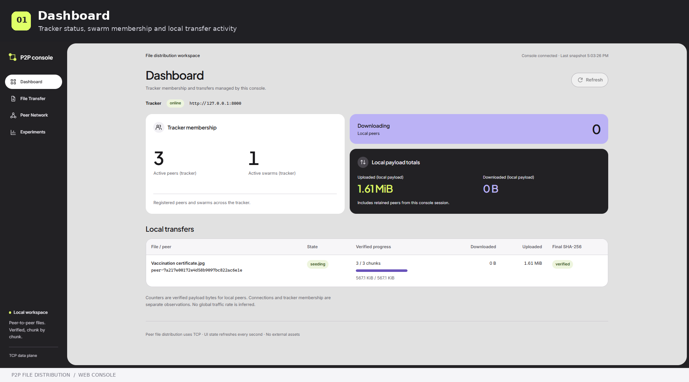
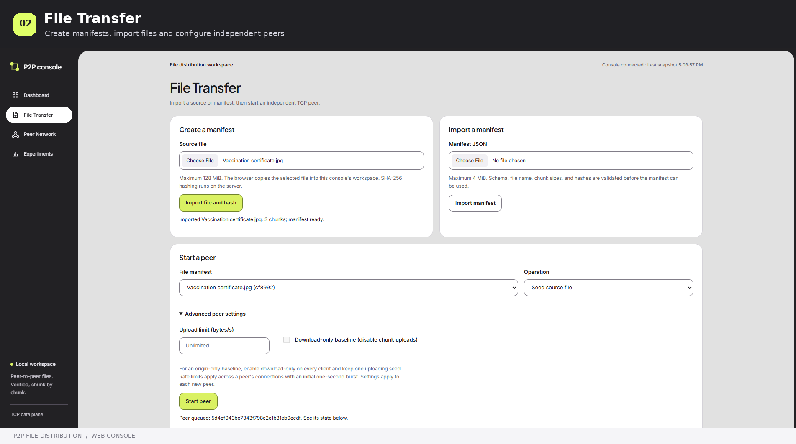
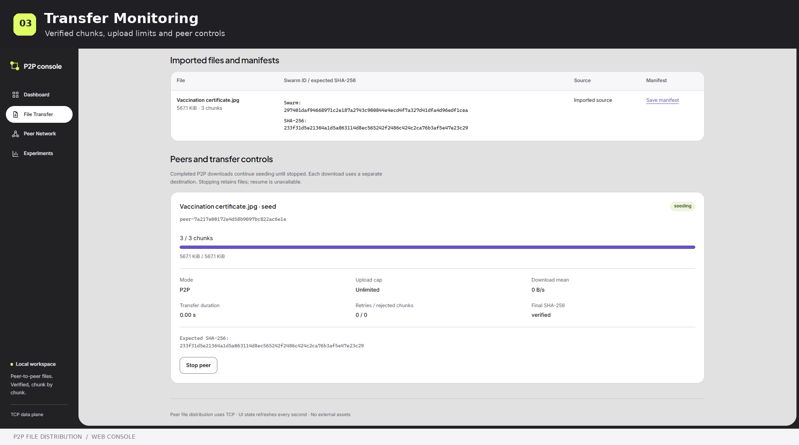
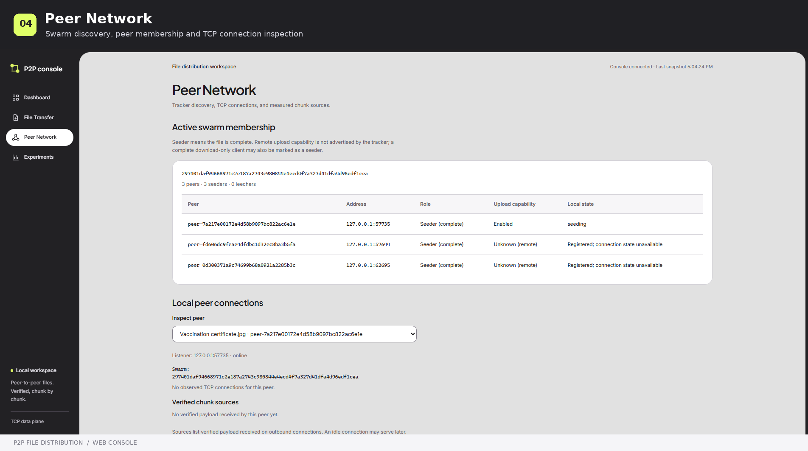
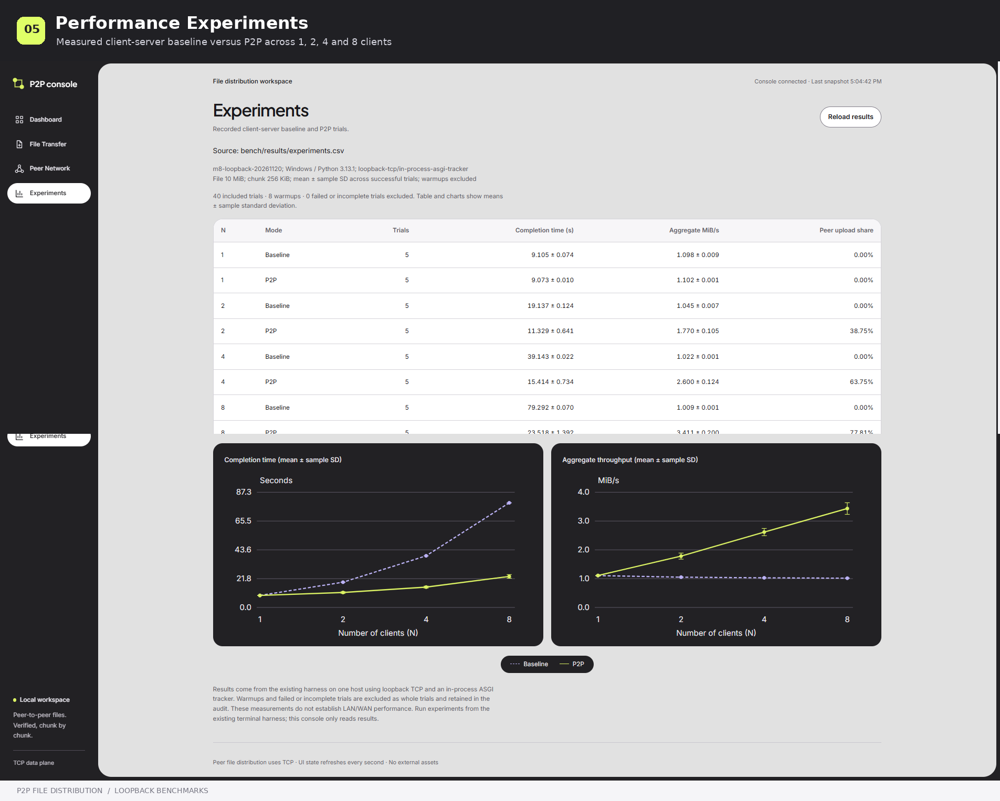
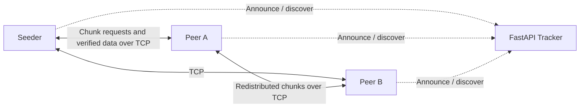

# BitTorrent-Style P2P File Distribution System

A **Python peer-to-peer file distribution system** that splits files into verified chunks and distributes them across multiple peers. Built with TCP sockets, asynchronous networking, a FastAPI tracker, and a local web console.

The project demonstrates how peers can **download and redistribute chunks**, reducing dependence on a single source as the swarm grows. It also includes a client-server baseline and reproducible performance experiments.

**Tech stack:** Python 3.12+ · `asyncio` · TCP · FastAPI · HTTPX · SHA-256 · HTML/CSS/JavaScript · pytest

## Interface

The local web console provides a visual interface for file transfers, swarm inspection, and recorded benchmarks. It runs on top of the same P2P engine used by the CLI.

### Dashboard



*Tracker health, active peers and swarms, local payload counters, and transfer verification status.*

### File sharing and downloading



*Create or import a manifest, then start a seeding or downloading peer. Advanced settings include upload limits and download-only baseline mode.*



*Monitor verified chunks, transfer metrics, integrity checks and peer lifecycle controls.*

### Peer network



*Inspect tracker membership, local TCP connections and verified chunk sources. Tracker membership is not proof that a peer contributed data.*

### Performance experiments



*Recorded client-server versus P2P experiments, with sample standard deviation and throughput comparisons.*

## How it works



1. **Create a manifest:** Divide a file into chunks and record SHA-256 hashes.
2. **Discover peers:** Peers announce themselves to the HTTP tracker and discover swarm members.
3. **Download chunks:** Peers request chunks over independent TCP connections, with bounded concurrency and retry handling.
4. **Verify integrity:** Each received chunk is checked before acceptance; the completed file is checked against its expected hash.
5. **Redistribute:** A completed P2P downloader can continue seeding verified data to other peers until stopped.

The tracker is the **control plane** for discovery; file payloads travel directly between TCP peers. The current implementation uses an externally shared manifest and does not provide automatic NAT traversal or browser-to-browser transfers.

## Features

- **Multi-peer downloads:** Concurrent chunk requests, scheduling, retries and peer failover.
- **Data integrity:** SHA-256 verification for individual chunks and completed files.
- **Peer lifecycle:** Tracker announcements, heartbeats, seeding and clean shutdown.
- **Upload control:** Token-bucket rate limiting and a download-only baseline mode.
- **Web console and CLI:** Real transfers, peer inspection and benchmark results.
- **Reproducible experiments:** Client-server versus P2P trials for 1, 2, 4 and 8 clients.

## Benchmark results

Recorded **10 MiB** file distribution experiments, using **256 KiB** chunks and five included trials per configuration:

| Clients | Baseline completion | P2P completion | P2P throughput | Peer upload share |
| ---: | ---: | ---: | ---: | ---: |
| 1 | 9.105 s | 9.073 s | 1.102 MiB/s | 0.00% |
| 2 | 19.137 s | 11.329 s | 1.770 MiB/s | 38.75% |
| 4 | 39.143 s | 15.414 s | 2.600 MiB/s | 63.75% |
| 8 | 79.292 s | 23.518 s | 3.411 MiB/s | 77.81% |

At **8 clients**, mean completion time was approximately **70.3% lower** than the baseline (**3.37× speedup**). These results come from a **single Windows host using loopback TCP and an in-process ASGI tracker**. They demonstrate behavior in the test environment, not measured internet or LAN performance. See [experiment methodology](docs/experiments.md) and [raw results](bench/results/experiments.csv).

## Quick start

**Requirements:** Python 3.12 or newer.

```bash
python -m venv .venv
```

Activate the environment:

```powershell
# Windows PowerShell
.\.venv\Scripts\Activate.ps1
```

```bash
# Linux / macOS
source .venv/bin/activate
```

Install dependencies:

```bash
pip install -r requirements.txt
```

**1. Start the tracker** in one terminal:

```bash
python -m p2p.cli tracker-start --host 127.0.0.1 --port 8000
```

**2. Start the web console** in another terminal:

```bash
python -m p2p.web --port 8090
```

Open **http://127.0.0.1:8090**. Import a file to create a manifest and start a seeder. For a second independent peer, open another console process with a different workspace and port:

```bash
python -m p2p.web --port 8092 --workspace downloads/web-console-2
```

Import the saved manifest into the second console and start a download. The file is transferred over TCP and verified before being offered for download.

For command-line-only usage, see the [CLI guide](docs/cli.md).

## Testing

```bash
pytest
ruff check .
```

The project includes unit, integration and end-to-end tests covering the protocol, manifest validation, storage, tracker, peer transfers and download behavior. For verification procedures, see [testing](docs/testing.md).

## Documentation

- [Architecture](docs/architecture.md)
- [Wire protocol](docs/protocol.md)
- [Manifest format](docs/manifest-format.md)
- [Web console guide](docs/web-ui.md)
- [Experiments and limitations](docs/experiments.md)
- [Course report](docs/course-report.md)
- [Demo guide](docs/demo.md)

---

*The web console is local-first; the benchmarks are controlled single-host measurements.*
