# P2P File Distribution: Complete Project Handbook

Study edition: 20 November 2026. Audience: a fifth-semester Computer Science student preparing a Computer Networks demonstration and viva.

Code reference: branch `feat/local-web-console`, commit `121b31f82b094ef68b3f512c83f4e8c33a6b5548`. Line references refer to this snapshot. This handbook describes the actual implementation, including the optional local console. It is not a specification for the public BitTorrent protocol.

The Markdown files in `docs/` are the source of truth for this study edition. Import this document into Notion as Markdown, or use its published chapter pages. Mermaid blocks contain editable diagram source; a Markdown importer may preserve them as code until you select Mermaid rendering. Repository-relative source links are for a local checkout; source paths and names remain readable in Notion.

Evidence labels used throughout: **Implemented** describes inspected code; **Tested** means an automated check was actually run; **Measured** refers only to committed benchmark observations; **Theory** explains a model; **Proposed** describes a future improvement. Test runtime is never a performance experiment.

## Table of contents

1. [Project overview](#chapter-1-project-overview)
2. [Complete architecture](#chapter-2-complete-architecture)
3. [Repository and source guide](#chapter-3-complete-repository-file-guide)
4. [Computer Networks fundamentals](#chapter-4-computer-networks-fundamentals)
5. [Custom P2P protocol](#chapter-5-custom-p2p-protocol)
6. [Tracker and discovery](#chapter-6-tracker-and-peer-discovery)
7. [Manifest and chunking](#chapter-7-file-manifest-and-chunking)
8. [Downloading and scheduling](#chapter-8-downloading-and-chunk-scheduling)
9. [Storage and integrity](#chapter-9-storage-and-integrity-verification)
10. [Asynchronous programming](#chapter-10-asynchronous-programming)
11. [Bandwidth limiting](#chapter-11-bandwidth-limiting)
12. [P2P and baseline](#chapter-12-p2p-vs-client-server-baseline)
13. [Web dashboard](#chapter-13-web-dashboard)
14. [End-to-end execution](#chapter-14-complete-end-to-end-execution-trace)
15. [Experiments](#chapter-15-experiments-and-performance-evaluation)
16. [Testing](#chapter-16-testing-and-reliability)
17. [Limitations](#chapter-17-limitations-and-engineering-trade-offs)
18. [University demo](#chapter-18-complete-university-demo-guide)
19. [Viva preparation](#chapter-19-complete-viva-preparation)
20. [Glossary](#chapter-20-technical-glossary)
21. [Quick revision](#chapter-21-quick-revision)

Independent companions: [revision](P2P_VIVA_QUICK_REVISION.md), [demonstration](P2P_DEMO_SCRIPT.md), [source map](P2P_SOURCE_CODE_MAP.md), [coverage and verification record](P2P_HANDBOOK_COVERAGE_CHECKLIST.md).

Published study library: [P2P File Distribution | Complete Project Handbook](https://app.notion.com/p/41eb29626ff5811785fdd572ff908886). Its handbook is organized into 21 chapter children, alongside the three independent guides. Creation and content readback succeeded; editable Mermaid source is preserved, with no claim of rendered diagram QA.

## Chapter 1: Project overview

### 1.1 The problem and the idea

Suppose eight students need the same large course dataset. In a traditional client-server system, one server sends eight complete copies. If that server's upload connection is the bottleneck, adding downloaders increases the time needed to finish distributing all copies.

Peer-to-peer, or P2P, distribution allows recipients to help. A **peer** is a participant that can both request data and serve data. The file is divided into numbered **chunks**. A student who has verified chunk 7 can send it to another student while still obtaining other chunks. The original sender supplies the initial information, but does not have to send every copy of every chunk.

A **swarm** is the set of peers participating in the same manifest-defined transfer. A **seeder** has the complete file; a **leecher** is still obtaining it. These are roles, not separate implementations. In the normal mode, a leecher can already upload verified chunks. A completed downloader continues serving until stopped.

Think of a class sharing a book as numbered photocopied sections. The tracker is the noticeboard listing which classmates are participating. The manifest is the section list with trusted checksums. TCP is the delivery channel. The scheduler chooses which section to request; storage checks and files each section in its correct place.

### 1.2 What makes this a networking project

This is more than an HTTP upload/download form. It implements message boundaries on TCP, a connection state machine, peer registration and expiry, chunk availability advertisements, parallel work across peers, reservations, retries and failover, verified storage, cancellation cleanup and controlled measurements. The web console operates that engine and displays copied observations; it does not replace it with browser-to-browser networking.

| Implemented and tested areas | Intentionally outside current scope |
|---|---|
| FastAPI tracker, in-memory swarm registry and four HTTP routes | Database, persistent tracker registry, tracker redundancy |
| Five-message custom version-1 TCP protocol | Public BitTorrent compatibility, UDP data transfer, DHT |
| Strict single-file JSON manifests, per-chunk and whole-file SHA-256 | Multi-file torrents, signed manifests, publisher authentication |
| Async listener, concurrent per-peer downloads, random chunk scheduling | Rarest-first, endgame duplication, request pipelining, choking/incentives |
| Partial-chunk redistribution, completed-peer relay | NAT traversal, automatic port forwarding, Internet deployment tooling |
| Upload token bucket, download-only baseline, CSV experiments | TLS on peer TCP, CPU/RAM telemetry, LAN/WAN benchmark claims |
| Local vanilla HTML/CSS/JS console under ADR 0009 | Remotely accessible console, login/accounts, automatic manifest distribution, resume |

P2P ideas appear in software distribution, content replication and large dataset delivery. Those are applications of the architecture, not evidence that this course implementation is ready for those production environments.

### 1.3 Introductions to speak aloud

**30 seconds:** “Our project distributes a single file through a tracker-assisted peer-to-peer swarm. A FastAPI tracker tells peers where to connect, while a custom TCP protocol carries numbered chunks directly between peers. Every chunk is checked with SHA-256 before acceptance, and the completed file is checked again. Downloaders can redistribute verified chunks. We demonstrate this in a local dashboard and compare it with an origin-only baseline under controlled upload limits.”

**Two minutes:** “The motivation is the original server's upload bottleneck. Sending a complete copy to every client consumes approximately N times the file size at the origin. Our system divides the file into chunks and describes them in a JSON manifest. The hash of the manifest's canonical JSON identifies the swarm. Peers register their addresses with an in-memory HTTP tracker, then connect directly over asyncio TCP streams.

“TCP provides ordered reliable bytes, but not messages. We implement a four-byte length prefix and five message types: HANDSHAKE, BITFIELD, REQUEST, PIECE and HAVE. A scheduler randomly selects an available missing chunk using a seeded generator and reserves it before awaiting network I/O. This prevents duplicate work within one downloader. Storage verifies the chunk's length and SHA-256, writes it at its offset in a temporary file, and verifies the whole file before atomic publication.

“A peer can upload verified chunks before finishing, and a completed downloader keeps serving. Our baseline disables advertising and uploading on every client while retaining the same transfer and integrity code. Upload token buckets create controlled bottlenecks. In the recorded N=8 loopback experiment, baseline mean makespan was 79.292 seconds versus 23.518 for P2P. Those are five-repetition shared-host results, not Internet performance claims. Main limitations include centralized discovery, no active-download reconnection to later peers, no resume, and no peer authentication or encryption.”

## Chapter 2: Complete architecture

### 2.1 Components and boundaries

The **control plane** exchanges information needed to coordinate work. The **data plane** carries file content. The tracker belongs to discovery control; peer TCP belongs to distribution data. Console HTTP is a local management/artifact path and is separate from both roles.

| Component: what and why | Implementation and principal entry points | Input → output; interactions | Failure behavior |
|---|---|---|---|
| Dashboard: human controls and observations | `web/static/index.html`, `app.js`, `style.css`; `refresh`, `setupUpload`, `renderNetwork` | Browser File/settings → local HTTP requests; snapshots → DOM and SVG | Shows validation/errors; retained state is labeled stale if console requests fail |
| Web controller: local HTTP adapter | `web/app.py:create_app`; route closures; `tracker_json` | Bounded raw bodies/JSON and catalog IDs → HTTP responses | 400/403/404/409/413/422/429/503 as applicable; no arbitrary client-supplied disk paths |
| Console service: owns local assets and peer tasks | `web/service.py:Console`, `Asset`, `Transfer`, `StartTransfer`, `finish_disk_task` | Validated imports/options → task-backed transfer records | Marks failed transfers; stop cancels and joins peer work; app shutdown closes all |
| Tracker: membership directory | `tracker/server.py`, `models.py`, `registry.py:SwarmRegistry` | Announcements → interval and up to 50 other peer descriptors | Bad fields rejected; stale records lazily removed; state lost on restart |
| Peer lifecycle: joins control and data planes | `peer/client.py:SwarmPeer.start`, `download`, `close` | Manifest, tracker URL, upload options → listener and verified output path | Startup rollback; heartbeat failures logged; completion announce can fail after file publication |
| TCP server and connection | `peer/server.py:PeerServer`; `connection.py:PeerConnection` | Accepted/opened streams → validated messages and connection state | Rejects over-capacity connections and protocol violations; owns socket cleanup |
| Downloader and workers | `peer/downloader.py:SwarmDownloader`, `DownloadWorker` | Connected peers + scheduler + storage → verified index set; `SwarmPeer.download` returns path | Bounded attempts; retire failed peer; release work; no available sources causes failure |
| Scheduler: pure work ownership | `peer/scheduler.py:DownloadScheduler` | Bitfields/HAVEs + local states → reserved chunk or `None` | Invalid parameters rejected; disconnection releases reservations |
| Manifest: layout and expected identity | `storage/manifest.py:build_manifest`, `validate_manifest`, `compute_swarm_id` | File/JSON → validated `FileManifest`, deterministic swarm ID | Rejects malformed, unsafe, oversized and inconsistent manifests |
| Storage: acceptance and publication | `storage/manager.py:StorageManager.write_chunk`, `finalize` | Chunk bytes/index → accepted chunk state; `.part` → verified target | Invalid chunks never accepted; incomplete or mismatched final file not published |
| Rate limiter: shared upload budget | `peer/rate_limiter.py:TokenBucketRateLimiter.acquire` | Payload byte count → wait until permitted | Cancellation propagates without subtracting an unfulfilled acquisition |
| Metrics/experiments: observations and comparison | `peer/metrics.py`, `SwarmPeer.snapshot`; `bench/run_experiments.py`, `analysis.py`, `plot_results.py` | Counters/CSV → snapshots, trial summaries, audit and plots | Missing/invalid data yields unavailable UI; failed trials retained and excluded as whole trials |

Paths in this table are beneath `src/p2p/` unless prefixed `bench/`. The tracker stores neither source files nor manifests. Each console has its own in-memory catalog. A manifest must be exported/imported out of band.

### 2.2 Overall system and control versus data

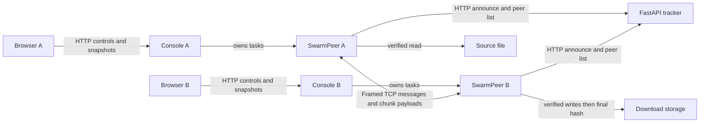

Browser-to-console arrows carry imports, settings and copied state over local HTTP. Ownership arrows mean the console starts/stops engine tasks, not another network hop. Each tracker arrow is an HTTP request/response exchanging membership. The horizontal peer arrow carries the custom protocol. Disk arrows mean local filesystem operations.

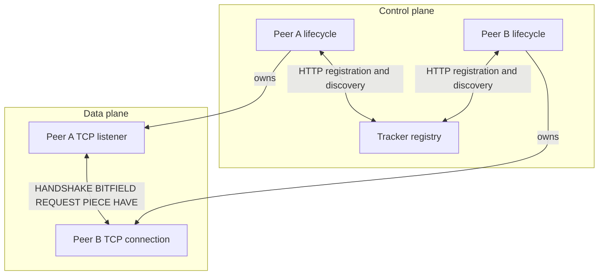

The two bidirectional control arrows exchange addresses/events; the data arrow exchanges application frames. The ownership arrows connect a peer's lifecycle to its socket machinery. Neither ownership arrow makes the tracker a relay.

### 2.3 Discovery, seeding and downloading diagrams

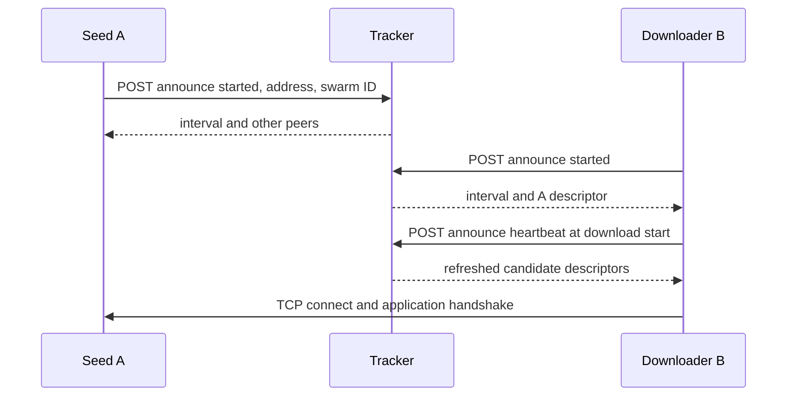

Each request arrow changes/refreshes membership; each dashed response returns a bounded list. The last arrow uses the returned address and does not contact the tracker for payload.

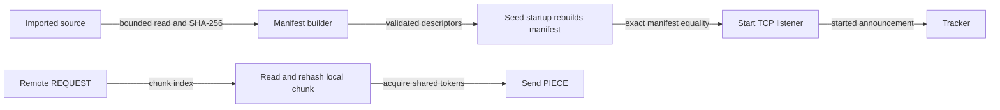

The first two arrows produce and then independently verify source metadata. Equality gates listener startup. Listener registration advertises a real bound port. For each later request, the read arrow selects only an available verified index, and the token arrow gates payload upload.

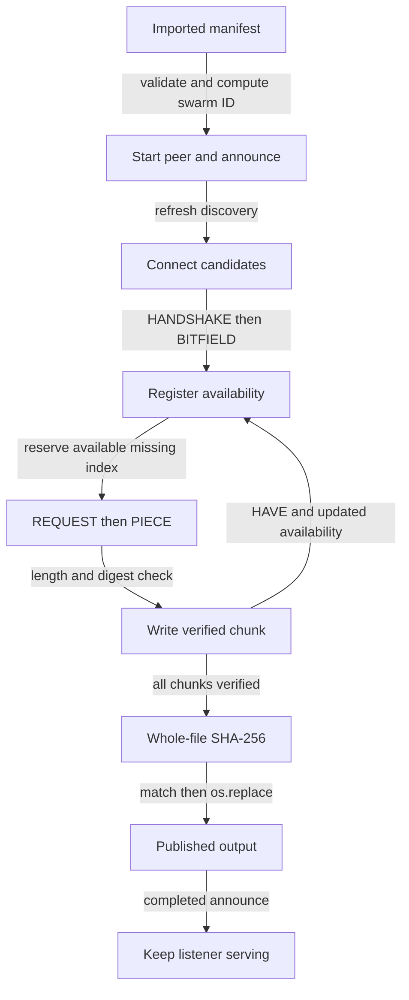

The loop is per-chunk download, verification and advertisement. The all-chunks arrow is a condition, not proof of final integrity. Only the whole-file-check arrow can lead to publication. The final arrow changes tracker completeness while leaving the listener alive.

### 2.4 Verification, redistribution and baseline diagrams

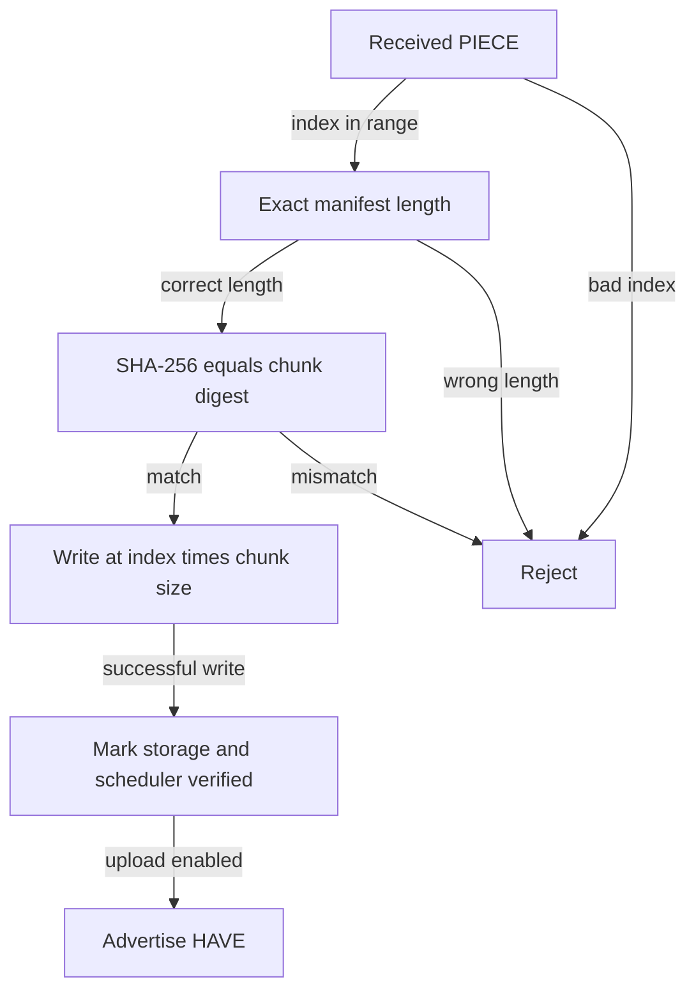

The positive arrows show the acceptance gates in order. The rejection arrows prevent bad data from becoming available. A duplicate already-verified storage index is ignored before revalidation; normal scheduling prevents asking for that duplicate in the first place.

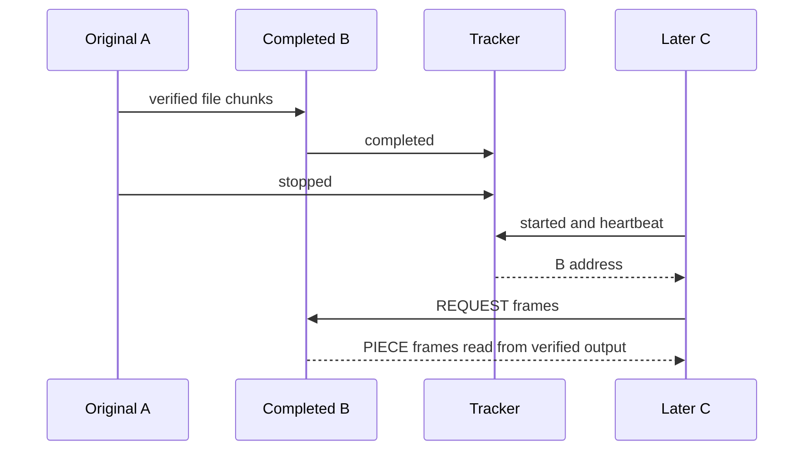

The first arrow represents the earlier full transfer. B's completion records completeness; A's stop removes the origin. C's discovery response identifies B. The last pair proves redistribution only when nonzero verified payload from B and C's final hash are observed.

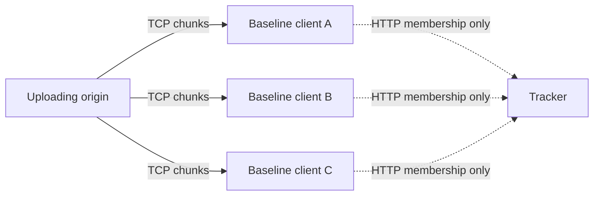

Solid arrows are payload deliveries; dotted arrows are registration/discovery. There are no client-to-client payload arrows because every client has uploads disabled. Baseline listeners and control connections can still exist.

### 2.5 Browser to backend

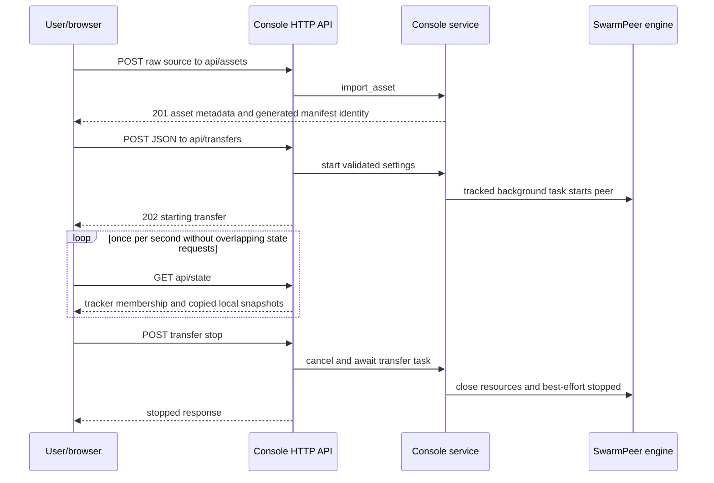

The source upload is a local HTTP artifact copy, not swarm distribution. A 202 response means queued, not completed. Poll responses observe the background task. Stop waits for the console's owned task cleanup.

## Chapter 3: Complete repository file guide

### 3.1 Actual layout

```text
src/p2p/
  __init__.py  config.py  cli.py
  protocol/   __init__.py  messages.py  codec.py
  tracker/    __init__.py  models.py  registry.py  server.py
  storage/    __init__.py  manifest.py  manager.py
  peer/       __init__.py  connection.py  server.py  client.py
              scheduler.py  downloader.py  rate_limiter.py  metrics.py
  web/        __init__.py  __main__.py  app.py  service.py  experiments.py
    static/   index.html  app.js  style.css  favicon.svg  fonts/
bench/        __init__.py  run_experiments.py  analysis.py  plot_results.py
  results/    experiments.csv  .gitkeep
  plots/      .gitkeep; ignored regenerated plots and derived CSVs
tests/        unit/  integration/  e2e/  helpers/  browser/console.mjs
docs/         specifications, guides, reports, handbook and adr/0001..0009
context/      PROJECT_CONTEXT.md
.agents/      shared skills
```

Root configuration includes `pyproject.toml`, `requirements.txt`, `.gitignore`, `AGENTS.md`, `README.md`, `PRODUCT.md`, `DESIGN.md`, `DESIGN_SYSTEM.md`, and `skills-lock.json`. Smoke payload/manifest/download files also exist locally; they are demonstration artifacts, not engine modules. `downloads/`, `output/`, virtualenvs and caches are ignored. There is no separate `src/p2p/manifest/` package: manifests live in `storage/manifest.py`.

### 3.2 Every production module

| File | Purpose and important symbols | Dependencies and interactions |
|---|---|---|
| `src/p2p/__init__.py` | Package version `0.1.0` | Packaging; no networking side effects |
| `src/p2p/config.py` | Protocol, time, connection and web bounds | Imported by codec, connections, tracker, peers and console |
| `src/p2p/cli.py` | `build_parser`, `_run_peer_command`, `main`; four CLI commands | argparse/Uvicorn/asyncio; manifest and `SwarmPeer` |
| `src/p2p/protocol/__init__.py` | Re-exports messages and codec functions | Public import surface; no separate protocol behavior |
| `src/p2p/protocol/messages.py` | `MessageType`, five frozen message dataclasses, `ProtocolError`, `ConnectionClosed` | JSON/regex/structural validation; codec and peers |
| `src/p2p/protocol/codec.py` | `encode_frame`, `encode_message`, `decode_body`, `decode_frame`, `read_frame`, `write_frame`, `read_message`, `write_message` | `struct`, asyncio streams, message types, config |
| `src/p2p/tracker/__init__.py` | Tracker package marker | No registry created here |
| `src/p2p/tracker/models.py` | Announce request/response, `PeerInfo`, detailed swarm responses, `AnnounceEvent` | Pydantic; IP/hostname validation; tracker routes and peer HTTP client |
| `src/p2p/tracker/registry.py` | `Clock`, `MonotonicClock`, `PeerRecord`, `SwarmRegistry` | Dicts, monotonic time, RNG; independent of HTTP routing |
| `src/p2p/tracker/server.py` | `get_registry`, `health_check`, `announce`, `list_swarms`, `get_swarm_peers`, FastAPI `app` | Explicit singleton registry; dependency overrides isolate tests |
| `src/p2p/storage/__init__.py` | Re-exports manifest/storage interfaces and errors | Stable convenience imports |
| `src/p2p/storage/manifest.py` | `FileManifest`, `ChunkDescriptor`, `ManifestError`; build/load/write/validate/identity helpers | pathlib/hashlib/JSON/tempfile; CLI, peer startup, console, benchmarks |
| `src/p2p/storage/manager.py` | `validate_safe_filename`, `StorageManager`; three integrity/completion errors | Synchronous file I/O and hashing; downloader and peer upload reads |
| `src/p2p/peer/__init__.py` | Re-exports peer classes | Import surface, not another coordinator |
| `src/p2p/peer/connection.py` | `ConnectionState`, `PeerConnection`, `normalize_socket_host` | asyncio streams, protocol; listener and connector |
| `src/p2p/peer/server.py` | `PeerServer.start`, `_handle_client`, `stop` | Connection factory and tracked handler tasks; `SwarmPeer` callback |
| `src/p2p/peer/scheduler.py` | `ChunkState`, alias `IN_FLIGHT`, `DownloadScheduler` | Pure state maps/sets and seeded RNG; worker/coordinator |
| `src/p2p/peer/downloader.py` | `DownloadWorker`, `SwarmDownloader`, `DownloadError`, `NoAvailablePeersError` | Connection, scheduler, storage; TaskGroup, reader queues, metrics |
| `src/p2p/peer/client.py` | `SwarmPeer` lifecycle, discovery, verified uploads, snapshot | HTTPX tracker control, peer server/downloader/storage/limiter |
| `src/p2p/peer/rate_limiter.py` | `TokenBucketRateLimiter` | Monotonic clock, lock, async sleep; shared by one peer's uploads |
| `src/p2p/peer/metrics.py` | Frozen `ConnectionSnapshot`, `PeerSnapshot` dataclasses | Observation schema; producer is `SwarmPeer.snapshot` |
| `src/p2p/web/__init__.py` | Optional console package marker | Does not modify CLI |
| `src/p2p/web/__main__.py` | `main`; port/tracker/workspace arguments | `create_app`, Uvicorn loopback binding |
| `src/p2p/web/app.py` | `create_app`, `tracker_json`, lifespan, middleware and route closures | FastAPI/HTTPX; `Console`; static files; experiments reader |
| `src/p2p/web/service.py` | `StartTransfer`, `Asset`, `Transfer`, `Console`, `finish_disk_task` | Bounded catalogs, UUID paths, streaming import, peer task ownership |
| `src/p2p/web/experiments.py` | `read_experiments` | Imports shared `bench.analysis` lazily; never runs trials |
| `src/p2p/web/static/index.html` | Four hash-routed sections, forms, native validation and output containers | Stable element IDs consumed by `app.js`; local CSS/JS/fonts/icon |
| `src/p2p/web/static/app.js` | HTTP wrapper, rendering, control enablement, polling, experiments charts | DOM/fetch/AbortSignal; console endpoints only |
| `src/p2p/web/static/style.css` | Tokens, layout, local fonts, focus, states and responsive rules | HTML classes and chart elements; no transfer algorithm |
| `src/p2p/web/static/favicon.svg` | Console icon | Served locally; packaged asset |
| `src/p2p/web/static/fonts/` | Two WOFF2 font files, OFL licenses and `sources.json` | Bundled assets; no runtime CDN requirement |
| `bench/__init__.py` | Benchmark package marker | Supports `python -m bench...` |
| `bench/run_experiments.py` | `ExperimentConfig`, `run_single_trial`, `run_experiments`, `append_rows`, `prepare_source`, `file_hash`, `get_system_metadata`, `parse_args`, `main` | Real peer TCP, local ASGI tracker, CSV, temporary directories |
| `bench/analysis.py` | `RunSummary`, `ConfigSummary`, `positive_number`, `parse_csv_results`, `calculate_stats` | Pure CSV validation/statistics; UI and plotter share it |
| `bench/plot_results.py` | `generate_all_plots`, `main` | Shared analysis; Matplotlib Agg; derived PNG/CSV output |
| `docs/build_course_report.py` | `inline`, `render_page`, `find_browser`, `build_report`, `main` | Limited renderer for existing course report; installed Chrome PDF export; not a general handbook renderer |

### 3.3 Reading the major APIs

Read in this order: manifest → storage → messages/codec → connection → tracker → scheduler/downloader → peer lifecycle → console → benchmarks. The [source map](P2P_SOURCE_CODE_MAP.md) adds exact definition lines and signatures, including private methods and frontend functions.

`build_manifest(file_path, chunk_size=262144) -> FileManifest` reads a nonempty file once, accumulates the whole-file hash and each chunk's hash, and returns a validated dictionary. CLI, source import, benchmark preparation and seed startup call it. Invalid chunk sizes or filenames raise `ManifestError`; filesystem errors propagate.

`validate_manifest(manifest: object) -> FileManifest` deliberately accepts `object`, because untrusted JSON is not trustworthy just because a caller annotated it. It enforces exact field sets, types, counts, ordering, lengths and hash syntax, then returns a copied validated structure. `load_manifest(path)` bounds file input before JSON parsing, rejects duplicate keys and invokes this validator. `compute_swarm_id` validates again before canonical hashing. `write_manifest` validates and atomically replaces its destination using a flushed, fsynced temporary file.

`StorageManager(manifest, download_dir)` establishes safe target/part paths and truncates a fresh `.part`. `write_chunk(index, data) -> bool` returns true for newly accepted bytes and false for an already-verified index; it raises rather than accepting invalid data. `finalize() -> Path` requires every verified index, hashes on-disk bytes, replaces the target and returns its path. It is called by the downloader through `asyncio.to_thread`.

`PeerConnection.connect(host, port, ..., local_bitfield)` opens a stream under a connect deadline and normally completes the application handshake before returning a connection. `accept` wraps inbound streams. `receive_message` enforces state/range/request correlation; `send_request` records an outstanding index before sending. `send_piece` and `send_have` frame messages. `close` shares one shielded cleanup task between concurrent callers.

`SwarmRegistry.announce(request) -> AnnounceResponse` mutates one swarm's record and returns a list excluding the caller. `evict_stale` returns an eviction count; diagnostic getters expose current records or lists. Routes validate external input and call these synchronous registry operations without an intervening `await`.

`DownloadScheduler.reserve_next(peer_id) -> int | None` selects only that peer's available missing indices, sorts them for reproducibility, makes a seeded random choice, and marks ownership immediately. `release` and `unregister_peer` make abandoned work eligible again. `mark_verified` is called after storage accepts the bytes; it does not hash them itself.

`DownloadWorker.fetch_next() -> int | None` performs one reservation and up to three attempts, with `0.05 * 2**attempt` delay between retries. Its `_request_one` sends a request, processes HAVEs while waiting, and writes the PIECE through storage. `None` can mean no eligible work or exhausted failure; `last_error` disambiguates. `SwarmDownloader.run() -> set[int]` owns all supplied connections, coordinates reader tasks and batches, finalizes storage and closes outbound connections in `finally`.

`SwarmPeer.start() -> int` verifies an optional seed source, binds the listener, announces started and launches heartbeats. `download() -> Path` refreshes discovery, connects candidates, creates scheduler/downloader, copies final metrics, announces completed and returns the published path. `wait_until_stopped()` keeps it serving; `close()` performs shared cleanup. A downloader's completed announcement is an HTTP operation after publication, so its failure can make the console show failure even if a verified target already exists internally.

`Console.import_asset(request, name, manifest_only)` streams a browser body into a UUID directory, then loads a manifest or builds one. `Console.start(options) -> Transfer` validates eligibility/capacity and queues `_run`; it does not await completion. `_run` constructs a peer and changes the transfer record's state. `stop(id)` is idempotent for a known transfer and awaits cancellation cleanup. Unknown IDs yield 404.

### 3.4 Documentation drift found during investigation

| Existing statement or example | Current code and correct interpretation |
|---|---|
| `docs/manifest.md` summary shows `chunk_count: 4` but only one chunk descriptor | This is an abbreviated schema sketch, not valid input. The validator requires all four descriptors. Chapter 7 uses a complete valid example. |
| Course report says “no frontend” | That report explicitly freezes an earlier measured revision. Current branch includes the optional console authorized by ADR 0009. |
| ADR 0006/0007 says later benchmarking work remains planned | Historical decision-time text; current runner, metrics and recorded sweep exist. Accepted ADRs are not silently rewritten. |
| Earlier project-status notes say baseline had no separate process smoke or all E2E use ASGI | Historical CLI coverage caveats remain; later `test_web_http_transfer.py` exercises separate console/tracker processes including baseline and relay. This does not turn the benchmark into a multiprocess benchmark. |
| Generic guidance suggests cooldown, tracker retry/reconnect, or per-swarm population caps | Actual download retries reuse the same connected peer first, then retire it. No timed cooldown/reconnect loop exists. Announce responses cap at 50; total registry population is not capped. |
| “Every remote-blocking await has a timeout” is a repository objective | Connect/handshake/read/request/HTTP operations have deadlines. Low-level `write_frame` drain, serving-side token acquisition/send and writer `wait_closed` do not each impose their own timeout. Do not claim universal per-await bounds. |
| Async code should not block on disk | Seed hashing/upload reads/finalization/import work are offloaded, but bounded `StorageManager.write_chunk` hashing/write/flush is synchronous inside download workers. Large-swarm event-loop latency remains a limitation. |
| README/AI-tooling skill counts differ | They describe earlier guidance sets; the actual `.agents/skills/` tree is authoritative. This does not change runtime behavior. |
| `DESIGN_SYSTEM.md` specifies 12px vertical table-cell padding | Current `style.css` uses 14px for headers and 16px for data cells. Treat the stylesheet as current rendered behavior; the handbook does not repeat the stale token value. |

## Chapter 4: Computer Networks fundamentals

For each row, read left to right: definition and analogy → technical mechanism → project use and source → viva prompt. These concepts describe networking generally; they do not imply new implemented features.

TCP's sequence/ACK/retransmission/window algorithms belong to the operating system, so there is no implementation of those algorithms in this repository to cite. Their application boundary is `PeerConnection.connect`/`receive_message` in `src/p2p/peer/connection.py` and stream reads/writes in `src/p2p/protocol/codec.py`. A networking concept's absence as a Python class does not mean the underlying transport lacks it.

| Concept: definition and analogy | Technical explanation | Project use and relevant source | Viva question and answer |
|---|---|---|---|
| Network: connected communicating devices; like roads joining houses | Hosts exchange packets through interfaces and links using layered protocols | Even loopback connects software endpoints; `peer/connection.py:connect` | Is loopback networking real? Yes: real OS sockets/TCP without a physical link traversal. |
| Host: machine participating in communication; a house | An IP stack provides addressing and transport endpoints | Several peer processes can share one host | Does one peer equal one machine? No; this project can run many on one laptop. |
| Client/server/peer: requester/provider/both; customer/shop/classmate | These are roles in an interaction, not fixed machine identities | `SwarmPeer` listens and connects; `PeerServer` accepts | Can a peer be a client and server? Yes, simultaneously on different connections. |
| IP address: network-layer destination; street address | IPv4/IPv6 route packets to an interface/host context; address alone does not identify an application | Tracker `PeerInfo.host`; `normalize_socket_host` strips IPv6 URI brackets | Why also need a port? Several services share an IP. |
| Localhost/loopback: local machine route; sending a letter to yourself | `127.0.0.1` is IPv4 loopback; `::1` is IPv6. Remote devices cannot use your loopback address to reach you | Console and managed peers bind `127.0.0.1`; tests use ephemeral loopback ports | Can another laptop open my console's 127.0.0.1? It reaches its own laptop. |
| Port: transport service number; apartment number | TCP ports identify listening services and connection endpoints; 0 asks the OS to choose for binding | Console HTTP ports differ from engine TCP ports; `PeerServer.start` reads assigned port | Is 8090 the peer chunk port? It is the chosen console HTTP port; managed peer TCP port is ephemeral. |
| Socket: OS communication endpoint; an installed telephone | A listening socket accepts connected sockets; established TCP flows are identified by local/remote addresses and ports | `asyncio.start_server`, `asyncio.open_connection` | Why keep a listener after completion? Later peers need to connect and request chunks. |
| TCP: connection-oriented ordered reliable byte service; tracked delivery | The OS performs sequencing, acknowledgments, retransmission, flow/congestion control | All peer frames and normal HTTP use TCP; `protocol/codec.py` handles messages above it | Does TCP verify our manifest? No; application SHA-256 does. |
| UDP: datagrams; individual postcards | Preserves datagram boundaries but does not itself guarantee delivery/order or retransmit lost data | No UDP peer transfer path exists | Why not UDP? It would require additional reliability/order/congestion machinery for this file-transfer design. |
| TCP three-way handshake: establish transport state; agree before speaking | SYN, SYN-ACK, ACK synchronize sequence spaces before application data | OS connect/accept happens before `perform_handshake` | Is HANDSHAKE our SYN? No; it is a framed application message after TCP establishment. |
| Reliable delivery: ordered bytes or surfaced failure; tracked parcels | Reliability is conditional on a viable connection; timeout/disconnection still happen | Application retries a chunk when an operation fails | Does reliability mean peers never fail? No, it does not keep remote processes alive. |
| Sequence number: byte position; numbered pages | TCP tracks positions in each direction's byte stream, not manifest chunk indices | The OS uses sequence numbers below `StreamReader` | Is REQUEST index a TCP sequence number? No, it identifies a file chunk. |
| ACK: acknowledgment of received stream progress; receipt | TCP acknowledgments confirm transport reception; not disk persistence or valid content | No application ACK message exists; PIECE answers REQUEST and HAVE announces availability | Does a TCP ACK prove SHA-256 passed? No. |
| TCP retransmission: resend unacknowledged bytes; repeat a lost parcel | OS timers/loss detection resend within the same transport connection | Transparent to codec; separate worker retries operate at chunk level | What is the difference from our retries? They resend application requests and can use another peer after retirement. |
| Flow control: protect a receiver; avoid overfilling its inbox | TCP receive window limits outstanding data relative to receiver buffering | `writer.drain` provides application backpressure; not the upload policy | Is token bucket TCP flow control? No, it is our configured payload budget. |
| Congestion control: protect network capacity; traffic management | TCP adjusts sending based on inferred congestion; implementation belongs to OS | We do not implement a congestion-control algorithm | Does a 64 KiB/s cap replace congestion control? No; both can constrain throughput. |
| Byte stream: ordered bytes without messages; continuous tape | Writes may split/coalesce; reads must reconstruct explicit application boundaries | `read_frame` uses `readexactly(4)` then `readexactly(length)` | Why not one read per PIECE? TCP preserves bytes, not write boundaries. |
| Application protocol: agreed message meaning; conversation rules | Defines framing, field encoding, valid states and errors above TCP | Five types in `protocol/messages.py`; validation in `PeerConnection` | Why version it? Peers must reject incompatible interpretations. |
| HTTP: request/response application protocol; service counter | Methods, paths, headers, status codes and bodies define interactions | Tracker and console FastAPI routes; HTTPX/fetch clients | Does HTTP carry chunks here? Swarm chunks use custom TCP; local imports/exports use HTTP. |
| REST API: resource-oriented HTTP interface; named service desks | Resources are addressed by paths; methods express operations. This project's action endpoints are pragmatic HTTP APIs | `/swarms/{id}/peers`, `/api/transfers` | What does 202 mean? Request accepted for background work, not finished. |
| JSON: structured text; labeled form | Objects/arrays/strings/numbers/booleans/null need schema validation after parsing | Manifests, HTTP and HANDSHAKE only; PIECE data stays binary | Is syntactically valid JSON necessarily a valid manifest? No. |
| Latency: delay for an operation; journey time | RTT is round-trip network delay; file completion includes many RTTs and processing/waits | Sequential requests per connection amplify RTT cost; `_request_one` | Why may WAN performance differ? Larger RTT, loss and real uplink constraints change the bottlenecks. |
| Bandwidth: available/configured transfer capacity; pipe width | Usually link bits/s; application caps here are bytes/s and count payload only | `upload_rate_limit`, `TokenBucketRateLimiter` | Convert 65,536 B/s to bit/s: 524,288 bit/s, excluding overhead. |
| Throughput: delivered volume per interval; actual water flow | Useful payload/time depends on protocol, waiting, disk, scheduling and limits | Downloader verified bytes/duration; benchmark `N*F/makespan` | Is configured cap the measured throughput? No. |
| Concurrent connections: overlapping progress; multiple conversations | Async tasks interleave while sockets wait; CPU execution is not automatically parallel | `SwarmDownloader` and `PeerServer`, 30 total peer connections | Does 32 global in-flight guarantee 32 simultaneous requests? No; at most one per connected worker, and connections cap at 30. |
| Timeout: a deadline for waiting; appointment cutoff | A local deadline stops an operation that may otherwise wait indefinitely | Connect 10s, application handshake 5s, frame header 60s/body 15s, request 15s | Does a timeout prove a peer is malicious? No; it may be slow or disconnected. |
| Network failure: inability to make useful progress; closed road | Connection refusal/reset, EOF, partial frame, stalled response and unreachable tracker differ | Codec exceptions, retirement and best-effort stop | What can recovery guarantee? Completion only if reachable connected peers can supply all missing chunks within policy. |

### 4.1 Responsibilities by layer

| Operating system TCP provides | This application provides |
|---|---|
| Connection establishment and byte sequencing | Version/swarm/peer application handshake |
| ACKs and packet retransmission | Chunk request tracking, retry attempts and peer retirement |
| Ordered stream delivery | Frame length/type/field parsing and state validation |
| Receive-window flow control and congestion control | Resource caps, bounded queues, shared upload token bucket |
| Detection/surfacing of some transport errors | Safe storage, manifest SHA-256 checks, final publication and UI errors |

TCP checksums protect transport delivery against many errors but are not cryptographic content identity checks. Even perfectly delivered bytes can be deliberately wrong file data. That is why the application checks SHA-256 against the manifest.

## Chapter 5: Custom P2P protocol

### 5.1 Exact framing and limits

Implemented in `src/p2p/protocol/codec.py` and `messages.py`; version and shared constants are in `config.py`.

```text
frame = uint32_be(body_length) || uint8(message_type) || payload
body_length = 1 + len(payload)
wire_frame_length = 4 + body_length
```

`||` means concatenate bytes; `uint32_be` is a four-byte unsigned big-endian integer. “Big-endian” puts the most significant byte first: integer 5 is `00 00 00 05`. Python `struct.Struct("!I")` implements it. The four-byte prefix does not count itself.

| Boundary/deadline | Implemented default |
|---|---|
| Protocol version | 1 |
| Maximum chunk payload | 1,048,576 bytes |
| Maximum frame body | 1,048,581 bytes = type + index + maximum chunk |
| Maximum entire frame | 1,048,585 bytes including prefix |
| HANDSHAKE JSON payload | 4,096 bytes; type byte is additional |
| Default chunk | 262,144 bytes |
| Socket connect | 10 seconds |
| Entire application handshake + bitfield exchange | 5 seconds |
| Waiting for the complete next four-byte frame prefix | 60 seconds in steady state |
| Waiting for the complete frame body | 15 seconds |
| Worker request send/wait/accept operation | 15 seconds |

`read_frame` reads and checks the prefix before reading the body. The outer bound applies first; message-specific bounds are checked when decoding the body. Thus handshake-specific 4 KiB rejection occurs after reading an outer-bounded body; it is not a separate header-first 4 KiB allocation guard. `decode_body` is the body parser; `decode_frame` additionally validates an already-buffered prefix/body match.

`write_message` calls `encode_message` then `write_frame`, which writes and drains. `PeerConnection` supplies a per-connection write lock so concurrent HAVE/PIECE sends cannot interleave frames. That helper does not set its own write deadline; some callers provide an enclosing timeout.

### 5.2 All five messages

| Type | Sender → receiver; purpose | Exact fields and encoding | Validation/failure |
|---|---|---|---|
| `0x01 HANDSHAKE` | Both peers → each other immediately after TCP connect; establish compatibility and swarm | UTF-8 compact JSON: `version` integer 1, `peer_id` string, `swarm_id` 64 lowercase hex, `listen_port` integer 1..65535 | Peer ID regex `[a-zA-Z0-9_\-.]{1,64}`; booleans rejected as ints; JSON object and required fields required; self/wrong swarm rejected by connection; close on invalid handshake |
| `0x02 BITFIELD` | Both peers → each other after valid handshake; advertise upload availability | Exactly `ceil(chunk_count/8)` payload bytes. Index i is bit `7-(i%8)` in byte `i//8` | Correct byte count, nonempty field, zero unused trailing bits. Only once during exchange; repeat in steady state closes connection |
| `0x03 REQUEST` | Downloader → serving peer; request one complete chunk | Exactly four payload bytes: unsigned big-endian `chunk_index` | Codec enforces uint32; connection enforces index below manifest count; sender rejects duplicate pending index/cap overflow |
| `0x04 PIECE` | Server → requester; deliver chunk | Four-byte index then nonempty raw data, at most 1 MiB | Reject out-of-range/unsolicited index; worker requires its requested index; storage requires exact chunk length/digest |
| `0x05 HAVE` | Peer → connected peers after verification; increment availability | Exactly four-byte index | Index below chunk count; receiving connection updates remote bitfield; scheduler reader records new availability |

The handshake parser requires the four named fields but permits additional JSON fields and does not reject duplicate keys like the manifest loader does. Do not extend the manifest's strict “exact fields/no duplicates” policy to HANDSHAKE without a code change. All malformed message failures are local exceptions and connection closure, not a sixth wire ERROR message.

Example HANDSHAKE JSON payload, with a syntactically valid illustrative swarm ID:

```json
{"version":1,"peer_id":"peer-A","swarm_id":"aaaaaaaaaaaaaaaaaaaaaaaaaaaaaaaaaaaaaaaaaaaaaaaaaaaaaaaaaaaaaaaa","listen_port":9101}
```

The actual swarm ID must come from the real manifest. For a ten-chunk swarm, all chunks available is `ff c0`, none is `00 00`, and only indices 0 and 9 is `80 40`. The six low bits in the final byte are spare and must be zero. A baseline client sends zeros even when its file is complete.

Exact examples for index 2:

```text
REQUEST: 00 00 00 05 | 03 | 00 00 00 02
HAVE:    00 00 00 05 | 05 | 00 00 00 02
PIECE for data "ij":
         00 00 00 07 | 04 | 00 00 00 02 | 69 6a
BITFIELD for three complete chunks:
         00 00 00 02 | 02 | e0
```

`69 6a` are the ASCII byte values of `ij`. The PIECE body is 1+4+2=7 bytes, and the entire frame is 11 bytes. No base64 or JSON wrapper surrounds chunk payloads.

### 5.3 Complete annotated exchange

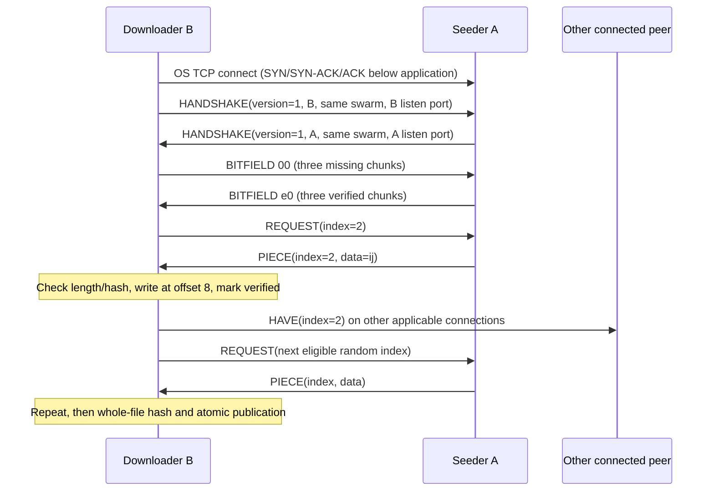

Both sides send HANDSHAKE first, then read; neither waits indefinitely for the other to speak first. The ordering shown between opposing handshake arrows is illustrative. HAVE routing is precise: the downloader broadcasts to other outbound peers excluding the chunk source, and `SwarmPeer._on_chunk_verified` notifies its established inbound connections. A single outbound source is not automatically sent a HAVE for the chunk it just supplied.

Connection states are `UNCONNECTED → AWAIT_HANDSHAKE → AWAIT_BITFIELD → STEADY_STATE → CLOSED`. Accepted streams begin at `AWAIT_HANDSHAKE`. In steady state only REQUEST, PIECE and HAVE are allowed. Clean EOF on a frame boundary becomes `ConnectionClosed`; partial prefix/body is `ProtocolError`. Unknown types, wrong fixed sizes, invalid bitfield and unsolicited pieces are rejected. No partial malformed message is “repaired.”

**Viva explanation:** “TCP delivers a stream. Our prefix tells us how many bytes belong to the next application message; the type byte tells us how to parse those bytes. We validate size before reading the body and validate meaning against connection state and manifest before accepting data.”

## Chapter 6: Tracker and peer discovery

### 6.1 Registry model and lifecycle

The tracker is a rendezvous point. Without a tracker or another discovery mechanism, a peer would need manually configured addresses. It does not need to possess the file because its job is finding participants.

`SwarmRegistry._swarms` is `dict[swarm_id, dict[peer_id, PeerRecord]]`. Each record contains `peer_id`, advertised `host`, `port`, monotonic `last_seen`, and `is_seeder`. The pair `(swarm_id, peer_id)` identifies membership. The tracker accepts advertised addresses; it does not prove reachability, possession or identity.

| Event | Exact registry behavior |
|---|---|
| `started` | Create record or refresh existing address/time; preserve/promote completeness |
| `heartbeat` | Refresh address/time; create missing record, allowing re-registration after tracker restart |
| `completed` | Create/refresh record and mark complete |
| `stopped` | Remove record if present; remove empty swarm; return empty peer list; repeated stop is safe |

Existing `is_seeder=True` is sticky: later false announcements do not demote it. Peers normally announce complete after finalization, but tracker completeness is an unverified report. In baseline mode a complete upload-disabled client still has `is_seeder=True`. Actual offered chunks come from BITFIELD/HAVE, not tracker role labels.

`announce` first evicts stale records for the affected swarm. It excludes the announcing peer, returns every other peer if there are at most 50, or uses RNG sampling to select 50. This is a response-size limit, not a 50-peer total swarm limit. Registry state and diagnostic listings are not globally population-bounded.

### 6.2 Actual endpoints and examples

| Method and path | Function | Response |
|---|---|---|
| `GET /health` | `tracker.server.health_check` | `{"status":"ok","service":"tracker"}` |
| `POST /announce` | `tracker.server.announce` → `SwarmRegistry.announce` | `interval` and compact `peers` with peer_id/host/port |
| `GET /swarms/{swarm_id}/peers` | `tracker.server.get_swarm_peers` | Swarm ID and diagnostic records including last_seen/is_seeder |
| `GET /swarms` | `tracker.server.list_swarms` | Array of active swarm diagnostic responses after lazy expiry |

For an empty tracker, first register A, then B. These are illustrative exact-schema requests using the same syntactically valid sample ID, not measurements:

```http
POST /announce HTTP/1.1
Host: 127.0.0.1:8000
Content-Type: application/json

{"swarm_id":"aaaaaaaaaaaaaaaaaaaaaaaaaaaaaaaaaaaaaaaaaaaaaaaaaaaaaaaaaaaaaaaa","peer_id":"peer-A","host":"127.0.0.1","port":9101,"event":"started","is_seeder":true}
```

A's response is `{"interval":30,"peers":[]}`. B then sends:

```json
{"swarm_id":"aaaaaaaaaaaaaaaaaaaaaaaaaaaaaaaaaaaaaaaaaaaaaaaaaaaaaaaaaaaaaaaa","peer_id":"peer-B","host":"127.0.0.1","port":9102,"event":"started","is_seeder":false}
```

B receives:

```json
{"interval":30,"peers":[{"peer_id":"peer-A","host":"127.0.0.1","port":9101}]}
```

Diagnostic `GET /swarms/aaaaaaaaaaaaaaaaaaaaaaaaaaaaaaaaaaaaaaaaaaaaaaaaaaaaaaaaaaaaaaaa/peers` returns this shape (times are illustrative monotonic readings, not calendar timestamps):

```json
{"swarm_id":"aaaaaaaaaaaaaaaaaaaaaaaaaaaaaaaaaaaaaaaaaaaaaaaaaaaaaaaaaaaaaaaa","peers":[{"peer_id":"peer-A","host":"127.0.0.1","port":9101,"last_seen":1000.0,"is_seeder":true},{"peer_id":"peer-B","host":"127.0.0.1","port":9102,"last_seen":1001.0,"is_seeder":false}]}
```

Use real manifest-derived IDs for actual transfers. Announce input rejects unknown fields, malformed IDs, bad ports, non-boolean seeder values and invalid IPv4/IPv6/hostname syntax with HTTP 422. Unknown but valid swarm IDs return HTTP 200 with an empty peer list. A stopped response always has an empty peer list.

### 6.3 Heartbeats, expiry and failures

Normal interval is 30 seconds. Expiry is strictly `now - last_seen > 3*30`, so a record exactly 90 seconds old remains. Expiry is lazy on announce/list operations or explicit `evict_stale`, not a background deletion every second. `last_seen` is monotonic time inside one tracker process and cannot be treated as a wall-clock date or compared across restarts.

`SwarmPeer.start` binds before announcing, remembers peers from the response, then follows the returned heartbeat interval. `download` sends another heartbeat and attempts candidate connections once. Regular heartbeats continue refreshing known descriptors, but the active downloader does not connect to later arrivals.

If tracker startup registration fails, peer startup rolls back listener/HTTP resources. If a periodic heartbeat fails, the peer logs it and continues; an existing TCP transfer can still progress. If the tracker is unavailable at download-start discovery, download fails. If final completed announcement fails, the file may already be verified and published but `download()` raises. Stop announcement is best effort; stale expiry eventually removes ungraceful departures when read/announce activity triggers cleanup.

**Viva explanation:** “Discovery is centralized, but file movement is peer-to-peer. Tracker failure affects new discovery and lifecycle reporting; it does not route or interrupt every already-connected chunk automatically.”

## Chapter 7: File manifest and chunking

### 7.1 What, why and sizing

A manifest is the file's transfer contract: safe filename, total size, chunk boundaries and expected SHA-256 digests. A downloader can validate a chunk before possessing the complete file. Chunks also create independent scheduling/retry units and allow partial redistribution.

For file size `F > 0`, nominal chunk size `C`, and zero-based index `i`:

```text
chunk_count K = (F + C - 1) // C = ceil(F/C)
offset(i) = i*C
length(i) = min(C, F - i*C), for 0 <= i < K
```

Example: `F=10`, `C=4` gives three chunks: `abcd` at offset 0/length 4, `efgh` at offset 4/length 4, `ij` at offset 8/length 2. An exact multiple has a full final chunk, not an extra empty chunk. Empty files are rejected.

Smaller chunks improve work granularity and reduce retry waste but increase requests, descriptors, hashes and scheduler work. Larger chunks reduce overhead but increase single-request delay and time before the next shareable unit. Default is 256 KiB, maximum 1 MiB; chunk count is at most 30,000 and encoded manifest at most 4 MiB. The console additionally caps sources/downloads at 128 MiB. There is no UI chunk-size control; use the CLI to create a different valid layout.

### 7.2 Complete valid schema example

The following manifest describes exactly the ten bytes `abcdefghij` in `sample_dataset.bin`. Hashes are actual SHA-256 values for these bytes, not placeholders.

```json
{
  "manifest_version": 1,
  "file_name": "sample_dataset.bin",
  "file_size": 10,
  "chunk_size": 4,
  "chunk_count": 3,
  "file_sha256": "72399361da6a7754fec986dca5b7cbaf1c810a28ded4abaf56b2106d06cb78b0",
  "chunks": [
    {"index":0,"length":4,"sha256":"88d4266fd4e6338d13b845fcf289579d209c897823b9217da3e161936f031589"},
    {"index":1,"length":4,"sha256":"e5e088a0b66163a0a26a5e053d2a4496dc16ab6e0e3dd1adf2d16aa84a078c9d"},
    {"index":2,"length":2,"sha256":"c9df9c3f2963b19b9b95f58c4d33b053fa9f8586dd6ee04126e52a868f882108"}
  ]
}
```

These seven top-level fields and three descriptor fields are exact sets. Unknown/missing fields, boolean-as-integer values, nonpositive size, invalid counts, unordered indices, wrong lengths and uppercase/nonhex digests are rejected. Loading reads at most limit+1 bytes to detect oversize input before parsing; duplicate JSON keys are rejected. Validation establishes structural consistency, not that the unknown content's file hash agrees mathematically with its chunk hashes. Finalization checks the real bytes.

### 7.3 Canonical identity

SHA-256 maps bytes to a 256-bit digest, usually written as 64 hexadecimal characters. Equal bytes produce equal hashes; a digest is not reversible encryption. The project hashes both each chunk and the whole file because they answer different questions: “may I accept/share this chunk?” and “does the reconstructed on-disk file match the expected content?”

```python
validated = validate_manifest(manifest)
canonical = json.dumps(validated, sort_keys=True, separators=(",", ":")).encode("utf-8")
swarm_id = hashlib.sha256(canonical).hexdigest()
```

Python's default JSON string escaping also applies; this is the project's precise serialization recipe, not a claim to implement a separate universal canonical-JSON standard. Formatting/key order differences in imported JSON do not change identity after validation and canonicalization. Changing filename or chunk size does change the swarm ID because those fields are hashed. The same file content can therefore belong to different manifest-defined swarms. Whole-file SHA-256 is content identity; swarm ID is manifest identity; a filename alone proves neither.

### 7.4 Safe names and trust

`_validate_file_name` rejects empty or over-255-character names, `.`/`..`, slash/backslash/NUL/colon, trailing space/dot, and reserved Windows device basenames. `validate_safe_filename` resolves the destination and rejects a symlink or escaping parent. The console also rejects symlink subdirectories beneath its workspace and uses generated UUID catalog paths.

This prevents accepted metadata from directly choosing arbitrary output paths. It is not a sandbox against a hostile local user racing filesystem changes. The manifest must come through a trusted out-of-band channel if publisher identity matters; the tracker does not distribute it or authenticate it.

**Viva explanation:** “Chunk hashes permit early independent verification; the final hash checks reconstruction. A trusted expected hash gives integrity relative to that expectation. If an attacker replaces both data and manifest, our hashes alone cannot identify the original publisher.”

## Chapter 8: Downloading and chunk scheduling

### 8.1 The implemented strategy

The scheduler is seeded random selection among **this peer's available missing chunks**. It is not rarest-first, sequential-only, fastest-peer selection, tit-for-tat or endgame duplication. `DownloadScheduler` defaults to `random.Random(0)`; `SwarmPeer` also defaults its scheduler seed to zero. Benchmark clients use distinct recorded seeds `42 + client_index`, paired between modes.

Local state lives in `_states[index]`, reservation ownership in `_inflight[index] = peer_id`, and remote availability in `_peer_chunks[peer_id]`. Registering a peer converts its compact bitfield into a set of chunk indices. HAVE adds an index. A peer may advertise many chunks but have no current work because another worker reserved them.

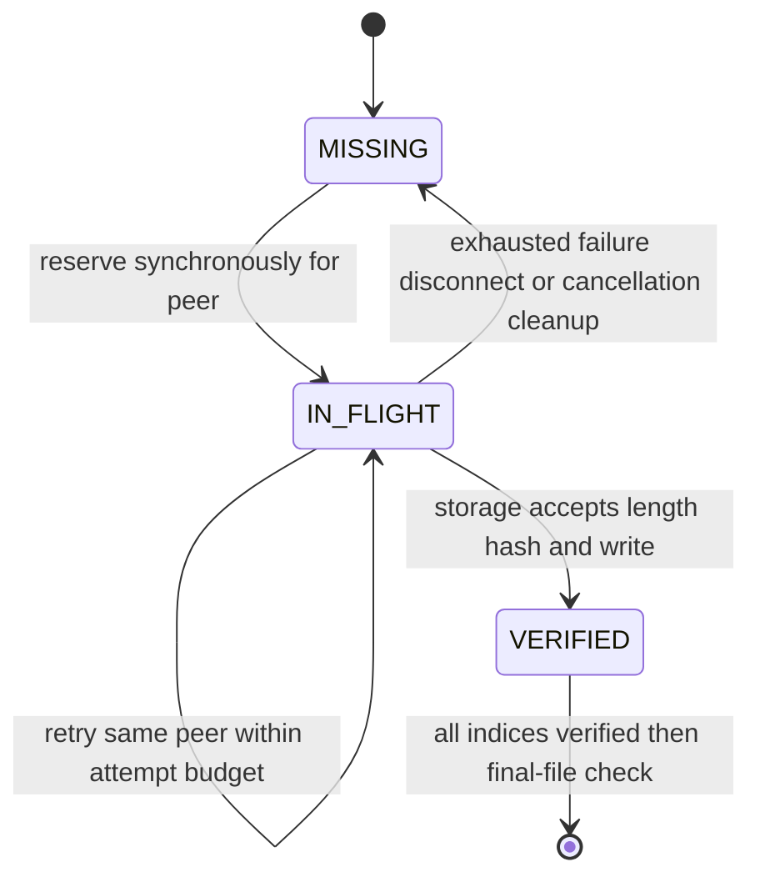

The retry self-loop preserves ownership; another worker cannot reserve that index during retry delay. The verified-to-end arrow represents chunk scheduling completion, not a guarantee that the whole-file check succeeds. The actual `ChunkState` enum has only MISSING, IN_FLIGHT and VERIFIED; final integrity belongs to storage.

### 8.2 Actual algorithm pseudocode

```text
SwarmPeer.download:
  require started peer, download storage, no simultaneous download call
  POST heartbeat; remember returned peers
  deduplicate candidates, exclude self/already-inbound-connected peers
  connect/handshake in capacity-bounded batches; try later candidates after failures
  if no connection succeeds: fail NoAvailablePeersError
  make scheduler and SwarmDownloader with upload-advertisement policy
  await downloader.run; copy counters even on failure/cancellation
  restore inbound connection capacity
  mark all local indices available; update listener bitfield
  POST completed; return storage target path

SwarmDownloader.run:
  start monotonic duration; register handshaken peer bitfields
  start one reader task and bounded queue per outbound connection
  until scheduler complete:
    retire peers with reader errors; release their reservations
    eligible = active peers advertising at least one missing chunk
    if eligible is empty:
      if no active peers: fail
      wait up to availability_timeout for HAVE/error; fail if no update
      continue
    launch one fetch_next task per eligible peer, up to global cap
    await the entire TaskGroup batch
    retire exhausted peers; verify that progress or retirement occurred
  await to_thread(storage.finalize)
  return verified indices
  finally: cancel/join readers, unregister active peers, close all owned connections

DownloadWorker.fetch_next:
  index = scheduler.reserve_next(peer)  # no await inside reservation
  if none: return none
  up to 3 attempts:
    under 15-second request deadline:
      send REQUEST(index)
      wait for requested PIECE, applying HAVE updates
      storage.write_chunk(index, bytes)  # verify before accept
      add accepted payload length to worker counter
    on success: scheduler.mark_verified; remember completion; return index
    on transfer error:
      record error/integrity failure and clear pending request
      if exhausted or connection no longer usable:
        release reservation; return none
      count retry; sleep 0.05 * 2**attempt
  cancellation propagates; owned cleanup releases reservations
```

This is explanatory pseudocode, not a new runnable API. The exact functions are `SwarmPeer._connect_to_peers`, `SwarmDownloader._read_peer_messages`, `_download_from_peer`, `_wait_for_peer_update`, `_retire_peer`, and `DownloadWorker._request_one`/`fetch_next`.

### 8.3 Worked reservation and failover example

Suppose six chunks are missing. A advertises `{0,1,2,3}` and B `{2,3,4,5}`. A's seeded selection chooses 2. Before sending or yielding, the scheduler marks `2 → IN_FLIGHT(A)`. B's candidate list excludes 2 even though B also has it; suppose B selects 5. Both network requests can now overlap.

If A returns correct bytes for 2, storage writes at offset `2*C`, records 2 verified and the worker marks scheduler state verified. If B returns corrupt bytes for 5, storage raises `ChunkIntegrityError` before writing. B's worker retains the reservation while retrying. The three-attempt maximum means one first attempt plus at most two retries, with nominal delays 0.05s and 0.10s.

After repeated failure, B is retired and 5 becomes missing. A cannot supply 5 in this example. If another already-connected peer advertises 5 via HAVE, it can be selected; otherwise the coordinator eventually fails. A peer discovered only after the download started is not automatically connected. This distinction prevents promising recovery from any arbitrary failure.

Reservation is needed because “check missing, await, then reserve” permits another coroutine to observe the same missing index during the await. A single-threaded event loop does not remove races across suspension points. The implementation makes selection and state mutation one synchronous operation.

### 8.4 Real concurrency and complexity

One reader owns each outbound TCP stream. Workers consume queued messages rather than competing to read the same `StreamReader`. Queues hold at most 32 message/error entries per connection. Reader tasks update HAVE availability immediately, including when that peer is not currently selected for a request.

There is one outstanding worker request per peer. `MAX_INFLIGHT_PER_PEER=4` is a connection API ceiling, not implemented four-request pipelining. `MAX_GLOBAL_INFLIGHT=32` and `MAX_PEER_CONNECTIONS=30` are upper bounds; actual active requests are at most the eligible connected peers and 30. Inbound/outbound connections share capacity, with inbound capacity reserved while outbound attempts run.

The coordinator awaits an entire batch before starting the next batch. A slow request can delay another request to a peer that finished early. It is concurrent, but not a fully work-conserving continuously refilled worker pool.

Let K be chunks and P connected peers. Scheduler states use O(K) space; availability sets can use O(PK). `reserve_next` filters/sorts up to K candidates: O(K log K) worst-case per selection, with O(K) temporary space; RNG choice itself is O(1). State lookup/marking and set membership are average O(1); scanning missing/verified sets is O(K). Across K reservations, selection can approach O(K² log K), separate from payload/hash work. Availability bitfields take `ceil(K/8)` wire bytes but become larger Python sets locally. These bounds explain why the simple scheduler is acceptable at course scale yet not a claim of production-scale efficiency.

## Chapter 9: Storage and integrity verification

### 9.1 Temporary storage and acceptance

`StorageManager` owns one download directory and target. Its constructor validates the manifest/name/path, creates the directory, and opens `<file_name>.part` in `wb`, starting a fresh file. It does not preallocate a complete verified file or load saved progress. Reusing a CLI directory with the same filename truncates an old `.part`; a successful finalization can replace an existing target. Use independent fresh destinations.

`write_chunk` is random-access storage: open `r+b`, seek to `index * chunk_size`, write exactly the accepted bytes, check for a short write, flush, then add the index to `_verified_chunks`. Chunks may arrive out of order. Writing chunk 2 first does not prove chunks 0 and 1 exist; only the verified-index set defines progress. A filesystem may represent unwritten regions as holes or zero-filled ranges.

| Input for chunk 0 expected to be `abcd` | Result |
|---|---|
| Four bytes `abcd` with the manifest digest | Accepted and written at offset zero |
| Four bytes `abXd` | Exact size but SHA-256 mismatch; rejected before write |
| Three bytes `abc` | Length mismatch; rejected before hashing acceptance |
| Negative/out-of-range/non-integer index | `ChunkIntegrityError` |
| Duplicate already-verified index | Returns false; existing accepted bytes not overwritten |

Storage verification occurs before scheduler verification and before upload advertisement. `ChunkIntegrityError` includes length/index/type/digest problems, so the metric called `chunk_hash_failures` or “rejected chunks” is broader than only digest mismatches. Ordinary network timeouts are not hash failures.

### 9.2 Finalization and atomic publication

`finalize` requires the verified set to equal all manifest indices. It flushes/fsyncs the `.part`, streams its SHA-256 from disk in bounded 1 MiB reads, and compares the digest with `file_sha256`. Only a match allows `os.replace(part_path, target_path)` and `_finalized=True`. Final integrity is `pending`, `failed` on an observed whole-file mismatch, or `verified` after successful publication.

An atomic replacement means readers of the target name do not see publication halfway through a rename. It is not a guarantee against every power-loss scenario: the implementation does not fsync the containing directory, and there is no transactional database. Chunk writes flush but do not each fsync; finalization does the file fsync before hashing/publication.

Incomplete finalization raises `IncompleteFileError`. A whole-file mismatch raises `FileIntegrityError`, marks final integrity failed and preserves the part for diagnosis. Disk permission/full-disk/short-write/rename errors propagate; accepted chunk counts cannot be treated as proof of successful finalization. Repeated finalize or writing after finalization raises.

Cancellation stops and joins owned network work; incomplete `.part` files remain. The console retains workspace files and does not offer resume. Failed source/manifest imports remove the attempted imported file after joining offloaded work; do not confuse that import cleanup with deleting partial downloads. `finish_disk_task` prevents cleanup racing an import worker thread that is still writing or validating.

### 9.3 Integrity, authenticity and confidentiality

| Property | Question answered | This project |
|---|---|---|
| Integrity | Do bytes match the expected content? | SHA-256 against a supplied manifest, per chunk and whole file |
| Authenticity | Who produced or authorized that expected content? | No signatures/authenticated publisher identity; trust manifest delivery separately |
| Confidentiality | Can an observer read the bytes? | No peer TCP encryption; raw chunk data is visible to an observer with network access |

`hmac.compare_digest` compares hashes without ordinary early-exit string comparison; using that function does not mean the file has an HMAC or secret authentication key. SHA-256 digests here are unkeyed.

**Viva explanation:** “We do not reconstruct by concatenating chunks in arrival order. We write each verified chunk at its manifest-defined offset, then hash the actual on-disk file before publishing its final name.”

## Chapter 10: Asynchronous programming

### 10.1 What async changes

Synchronous code waits for one operation before moving on in that thread. Asynchronous code lets a coroutine suspend while waiting for I/O, so an **event loop** can run another ready coroutine. Like a waiter handling several tables, it overlaps waiting; it does not turn one CPU into many CPUs.

`async def` defines a coroutine function. Calling it creates a coroutine object; `await` executes/suspends on an awaitable. A **task** schedules a coroutine independently. `TaskGroup` owns a group of tasks and waits for them, propagating failure/cancellation through structured concurrency.

| Concept | Actual implementation and example | Viva explanation |
|---|---|---|
| Coroutine | `SwarmPeer.download`, `PeerConnection.receive_message` | A resumable async operation, not an OS thread |
| Event loop | CLI uses `asyncio.run`; Uvicorn runs ASGI apps; benchmark uses one loop | Schedules ready work and socket readiness |
| Task | Heartbeat, connection handler, outbound reader, console transfer | Has an owner; must be cancelled/joined on shutdown |
| `await` | `await reader.readexactly(...)`, `await writer.drain()` | Permits other tasks to progress while this task waits |
| Lock | Per-connection write lock; one token-bucket lock | Protects an invariant across await points |
| Queue | One `asyncio.Queue(maxsize=32)` per outbound connection | Separates sole-reader dispatch from worker consumption with bounded buffering |
| Event | `_availability_changed`, `_stopped_event` | Signals availability changes or peer shutdown without polling the socket from multiple readers |
| Worker thread | `asyncio.to_thread(build_manifest/finalize/read)` | Keeps large blocking disk/hash work away from the event loop; not a new networking protocol |
| Cancellation | Stop calls `task.cancel`; `CancelledError` is re-raised | Cooperative interruption delivered at a suspension point, followed by cleanup |
| Shield | Shared close tasks and `finish_disk_task` | Protects owned cleanup/thread joining; it does not make the outer caller uncancellable |

### 10.2 Who runs concurrently

A console transfer task calls peer startup, then download or seed waiting. A peer owns a heartbeat task and `PeerServer`. The server tracks one handler per accepted connection. Each handler handshakes then runs `_serve_connection`, which reads requests and sends checked chunks sequentially on that connection.

During download, the coordinator creates one outbound reader per connection and one worker fetch per eligible peer per batch. The reader performs all receives on that stream and queues messages. The worker waits for its one requested piece. Other handlers can serve already-verified local chunks while workers receive more chunks.

No scheduler lock is necessary for ordinary same-loop reservation because it contains no await. This is not cross-thread safety. Storage's synchronous acceptance also completes without interleaving between asyncio tasks, but bounded chunk hashing/writing still blocks the loop for that interval. The final file hash is larger work and is offloaded.

### 10.3 Cleanup and failure ownership

`SwarmDownloader.run` cancels/joins readers, unregisters peer reservations and closes owned outbound connections in `finally`. `PeerServer.stop` closes the listener, cancels/joins handlers, closes active connections, then awaits listener closure. `SwarmPeer.close` cancels heartbeat, stops the server, best-effort announces stopped and closes HTTPX. Shared `_close_task` objects make concurrent closes wait for the same cleanup.

`Console.stop` cancels and awaits its transfer task; `_run` closes the peer in `finally`. `Console.close` stops every catalogued transfer during FastAPI lifespan shutdown. It also handles a transfer cancelled before its first instruction, when the coroutine's own finally never ran. Thread work cannot be forcibly stopped simply by cancelling the coroutine, which is why import cancellation joins the thread task first.

Some teardown waits have no individual deadline; tested cleanup is evidence for exercised paths, not a proof that every possible OS or remote fault is bounded. A local process crash can still leave files and stale tracker registrations.

Why asyncio? Many waiting sockets can share few threads, and explicit task ownership is testable. Limitations include blocking code delaying unrelated peers, CPU-bound hashing not becoming magically parallel, batch stragglers, and the need to reason carefully about cancellation and await boundaries.

## Chapter 11: Bandwidth limiting

### 11.1 Token bucket, as actually implemented

A **token bucket** converts elapsed time into permission to send bytes. Tokens are measured in payload bytes. `rate_bytes_per_sec=R` generates R tokens/second; `burst_bytes=B` is normal stored capacity. The bucket starts full. The default capacity equals one second of the rate, so `B=R` bytes numerically.

One limiter instance belongs to a `SwarmPeer`, shared across all serving connections. `SwarmPeer._serve_connection` reads/rechecks a chunk, awaits `acquire(len(data))`, sends PIECE and increments `bytes_uploaded`. The limiter counts raw PIECE data length, excluding frame headers, HTTP, TCP/IP overhead and transport retransmissions.

```text
acquire(n):
  validate positive integer n
  lock bucket (also while waiting)
  refill stored tokens: min(B, tokens + elapsed*R)
  if tokens >= n:
    subtract n; return
  deficit = n - tokens
  sleep deficit/R
  calculate tokens earned during that sleep
  if tokens + earned >= n:
    consume n; store min(B, remaining); return
  otherwise update bounded stored tokens and retry
```

The post-sleep earned-token calculation is essential when a whole chunk exceeds B. An implementation that always clamps to B before checking `tokens >= n` would never permit an oversized chunk. This limiter allows one whole acquisition to spend credits earned while it waited, even when n>B; it then sends the whole chunk. It is an application admission limiter, not byte-by-byte NIC pacing.

### 11.2 Numerical example: 65,536 bytes/second

Let `R=65,536 B/s = 64 KiB/s`, default `B=65,536 bytes`, and chunk length `n=262,144 bytes = 256 KiB`.

At startup 65,536 tokens are ready. First-chunk deficit is `262144-65536=196608` bytes, so nominal wait is `196608/65536=3 seconds`. After that acquisition, approximately zero tokens remain. A second chunk needs `262144/65536=4 seconds`. Two chunks can therefore be admitted after about seven seconds, plus read/send/processing overhead. Four such chunks require about fifteen seconds from the first acquisition, rather than sixteen, because of the initial burst.

If two connections ask at once, the shared lock serializes token acquisition. They do not each receive an independent 64 KiB/s budget. The second caller waits behind the first, and then for its own credits. FIFO lock acquisition assists ordinary waiting fairness, but the implementation is not a weighted fair queue or a guarantee of equal throughput per recipient.

### 11.3 Configuration and timeout interaction

CLI: `seed-file ... --upload-rate-limit 65536` or `download-file ... --upload-rate-limit 65536`. Omission means no application cap. Constructor validates finite positive numbers; console bounds are 1..1,073,741,824 bytes/s. UI settings apply only to a newly created peer, so stop/start to change them. Baseline clients disable uploads regardless of their configured limiter; the browser sends a null cap when its baseline box is checked.

The worker's 15-second request deadline includes waiting for a server's queued token acquisition and transfer. A 256 KiB chunk at 8 KiB/s initially needs 31 seconds and will exceed that deadline. Even at a higher rate, contention among several clients can make a request wait too long. Use suitable chunk sizes/caps/client counts rather than promising arbitrary very-low-rate success.

Expected token-bucket bound for admitted payload over an interval starting with a full bucket is approximately `bytes <= B + R*t`, subject to the whole-chunk admission model and normal scheduling. Observed short-interval throughput may exceed R because of B and burst sends. Useful download throughput may be lower due to hashing, waiting, batch scheduling and network capacity; aggregate P2P throughput can exceed one origin's R because many peers upload.

Arithmetic state is O(1); one uncontended acquisition typically has one sleep or none. Waiting time is workload dependent, and timer jitter can cause repeated loop iterations. Cancellation while waiting subtracts no unfulfilled n-byte acquisition and releases the lock. A peer disconnect does not itself synchronously cancel a serving handler that is asleep inside the limiter; send failure or higher-level shutdown reveals it later.

**Viva explanation:** “The cap belongs to a peer, not each socket. We account for payload bytes before sending, allow an initial burst, and share one locked budget across recipients.”

## Chapter 12: P2P vs client-server baseline

### 12.1 How the baseline is enforced

The baseline uses the same tracker, manifest, TCP framing, scheduler, storage and hashing code. Every downloading client sets `SwarmPeer(upload_enabled=False)`, exposed by CLI `--no-upload` or the console's **Download-only baseline** checkbox. The original seeder keeps uploads enabled.

Four enforcement points matter: `_local_bitfield` returns all zeros; `SwarmDownloader(advertise_chunks=False)` suppresses its HAVE; `_on_chunk_verified` tracks completeness but suppresses listener/HAVE advertisement; `_read_chunk` refuses uploading, so REQUEST closes the serving connection without sending PIECE. The policy persists after completion. Baseline clients retain listeners and heartbeats; “no upload” does not mean “no network traffic.”

This flag does not filter remote suppliers. If another normal uploading peer remains in the swarm, a baseline client can download from it. For an origin-only comparison, stop earlier uploading clients and keep exactly one uploading origin, with every current client opted out.

### 12.2 Theory, with variable definitions

Let F be file bytes, N downloading clients, `u_s` origin upload bytes/s, `u_i` each client's upload capacity, and `d_min` the smallest client download capacity. Ignoring protocol/hash overhead, churn, chunk granularity and initial token bursts, familiar lower bounds are:

```text
D_client_server >= max(N*F/u_s, F/d_min)
D_p2p           >= max(F/u_s, F/d_min, N*F/(u_s + sum(u_i)))
```

The baseline origin must send N copies. In P2P the origin must introduce the file's information at least once, every client must receive F, and all uploaders collectively must deliver N*F. These are optimistic lower bounds, not the code's exact runtime equations. Chunk availability propagation and topology can make actual time longer. Token buckets starting full can make a literal no-burst bound unsuitable for short project trials.

**Worked theory example:** `F=10 MiB`, `N=8`, `u_s=1 MiB/s`, each `u_i=0.5 MiB/s`, and assume nonlimiting downloads. Baseline lower bound is 80s. P2P lower bound is `max(10,80/(1+8*0.5))=max(10,16)=16s`. This predicts an opportunity; the recorded P2P mean is 23.518s, not 16s. The measured baseline mean is slightly below 80s because of the one-second initial origin burst and other timing details.

### 12.3 When P2P helps and when it may lose

P2P helps when the origin is constrained, enough uploading peers overlap in time, and useful diverse chunks spread early. At N=1 there is no other client to contribute, so extra machinery gives no inherent sharing benefit. Slow/unstable peers, restrictive download links, small files, high latency, insufficient chunk diversity, control overhead, CPU/disk contention and batch stragglers can reduce or reverse gains.

In the project, P2P reuses inbound serving handlers for uploads and outbound connections for requests. An inbound connection is not automatically turned into an outbound download worker. Avoid drawing an ideal fully connected mesh and assuming every edge carries chunks. Actual source counters provide evidence of useful transfers.

**Viva explanation:** “P2P makes recipients contribute upload capacity. It is not automatically faster; we isolate that contribution by disabling client uploads in an otherwise shared implementation and compare under explicit conditions.”

## Chapter 13: Web dashboard

### 13.1 Architecture, refresh and freshness

The frontend is a single local HTML document with vanilla JavaScript and CSS. Hash routes `#dashboard`, `#transfer`, `#network`, `#experiments` toggle sections; Back/Forward works and invalid hashes fall back to Dashboard. Fonts, icon, scripts and styles are locally bundled. There is no login, database, websocket, frontend build system, automatic manifest sharing or browser-launched benchmark.

`navigate(); refresh(); setInterval(refresh, 1000)` runs at boot. `refresh` coalesces overlapping `/api/state` requests rather than starting a second pending request. Therefore “every second” is polling cadence, not a guarantee of a new snapshot exactly once per second if responses are slow. The manual Refresh button and post-action refresh use the same integration.

`api()` adds `X-P2P-UI: 1`; GET timeout is 15,000ms, any explicitly supplied method uses 150,000ms. It parses JSON `detail` for non-success errors. Browser file downloads use anchors instead of this JSON helper. Console `/api/state` checks tracker health and membership under a three-second enclosing deadline; a tracker response is bounded to 4 MiB before JSON parsing.

Console connection and tracker availability are distinct. If console HTTP fails, the last successful display remains and is labeled stale. If console succeeds but tracker fails, local transfer observations can still update, while membership becomes unavailable. If health succeeds but `/swarms` fails, tracker can show online with membership unavailable. Unknown is never replaced by zero.

### 13.2 Dashboard: every displayed metric

| Display | Exact source/calculation | Interpretation |
|---|---|---|
| Tracker status, URL, error | `/api/state.tracker`; validated tracker `/health` and `/swarms` | Online is health availability, not proof every remote peer is reachable |
| Active peers (tracker) | Unique `peer_id` strings across returned swarms | Tracker-wide unique IDs; not count of established TCP connections. Reused IDs across swarms count once here. |
| Active swarms (tracker) | Length of tracker swarm array | Empty array means observed zero; null means unavailable |
| Downloading (local) | Count of local transfer records with state `downloading` | This console only; excludes seeding/completed/failed/stopped |
| Uploaded/local payload | Sum `metrics.bytes_uploaded` over retained local transfers | Application PIECE payload after successful send/drain; not global wire traffic |
| Downloaded/local payload | Sum `metrics.bytes_downloaded` | Accepted verified payload; excludes rejected chunks and transport overhead |
| Local transfer identity | Filename + peer ID, transfer ID before startup | Identifies this local managed task, not every swarm member |
| State | `Transfer.state` | Starting/downloading/seeding/completed/stopped/failed |
| Verified progress | Snapshot verified count and sum of exact descriptor lengths; native progress max=file size | Final short chunk counted correctly; not timer-based progress |
| Downloaded/uploaded per row | Copied engine counters | A seed can show all bytes verified with zero bytes downloaded |
| Final SHA-256 | `metrics.final_integrity` or pending | Separate pending/verified/failed observation; full chunk progress alone is insufficient |

Local totals include stopped records retained during this console process. Restart clears catalogs/history and does not restore them from persisted files. A short transfer may begin and finish between polls, so not seeing intermediate progress does not mean no TCP work occurred.

### 13.3 File Transfer: complete operation inventory

**Create a manifest:** Choose a required nonempty source file and press **Import file and hash**. The browser checks 128 MiB, posts the raw File body and URL-encoded basename, and reports uploading/hashing/success/failure. The server copies into `workspace/assets/<uuid>/`, builds a normal 256 KiB manifest in a thread and selects the imported asset after refresh. Importing does not start seeding. A source actually named `manifest.json` gets a separate generated-manifest filename to avoid collision.

**Import a manifest:** Choose JSON and press **Import manifest**. Browser cap is 4 MiB; server uses the existing bounded duplicate-key/schema/name loader. The asset has `can_seed=False` because metadata is not source bytes. Save/export remains available. Manifest-only seeding is disabled; choose Download instead. The filename of the uploaded JSON container can differ from the content's `file_name` without changing the described file.

**Start a peer:** Select the catalog entry and operation Download or Seed source file. In the initially open **Advanced peer settings**, optionally enter upload bytes/s or check baseline. Choosing seed clears/disables baseline. Baseline disables the upload cap and submits null. Start is disabled while a mutation is busy, tracker health is offline, no asset is selected, or a seed has no local source. Backend validation remains authoritative.

Settings JSON contains exactly `asset_id`, `kind`, optional `upload_rate_limit`, `download_only`; unknown keys are rejected. Asset ID is 32 lowercase hex characters; kind is seed/download; rate must be finite and between 1 and 1 GiB/s; baseline is strictly boolean. Seed + baseline is invalid. HTTP 202 queues a starting transfer; failures later appear on its card. Settings cannot change an existing peer.

**Imported files/manifests table:** Shows filename, size, chunk count, full swarm ID, expected whole-file SHA-256, whether source bytes exist, and **Save manifest**. The export is a validated manifest download, not automatic distribution to another console.

**Peer details:** Each card shows file and operation, state, ID, exact progress, P2P/download-only mode, upload cap, mean download throughput, transfer duration, retries/rejected chunks, final integrity, expected hash and individual error. Mean download throughput is verified bytes divided by downloader monotonic elapsed time, including finalization; it is not a sampled instantaneous rate. It excludes console startup/discovery setup before the downloader timer, unlike benchmark completion intervals.

**Stop peer:** Available for starting/downloading/seeding/completed peers; failed/stopped entries are disabled. It POSTs stop and awaits cancellation cleanup. A completed P2P download must remain stoppable because it is still serving. Stopping retains files; output remains exportable if it had already completed.

**Save verified file:** Appears only when `has_output=True`; server returns 409 until `Transfer.output` exists. The link downloads the console's verified file to the browser; it is not another P2P transfer. A seed source does not automatically get a download-output link. Independent transfers use separate UUID destinations.

### 13.4 Peer Network: what is observed and what is unknown

Membership comes from the tracker: full swarm ID, total peers, complete seeders and incomplete leechers, ID, advertised address and role. Upload capability is known only for peers owned by this console, because tracker records do not include that field. A remote complete baseline client may be called a seeder but its upload capability remains “Unknown (remote).” Registered membership does not prove a live connection.

The **Inspect peer** selector chooses a local transfer. It preserves selection across polls. Details show listener address/online flag and swarm ID, followed by observed inbound/outbound connections: remote ID or handshake pending, lifecycle state (closed rendered disconnected), advertised chunk count and pending request count. Advertised chunks are from the remote BITFIELD plus HAVE updates, not a request to the tracker. There are no remotely queried connection statistics.

**Verified chunk sources** shows positive accepted bytes by remote peer ID from the downloader. Contributions survive retired/closed outbound connections. Empty means no verified payload has yet been received; an idle connection alone is not a contribution. Closed outbound connections may remain visible in the copied downloader connection tuple. There is no full historical connection log, per-peer timeout counter or geographic network map.

### 13.5 Experiments

First navigation lazily calls `/api/experiments`; **Reload results** explicitly rereads the raw CSV. This does not use one-second state polling or execute a trial. The API calls shared `parse_csv_results`/`calculate_stats` in a thread, without importing Matplotlib for display.

The section shows source/caption, included/warmup/failed-incomplete counts, N=1,2,4,8 baseline/P2P rows with trial count, makespan mean ± sample SD, aggregate MiB/s mean ± sample SD, and mean peer upload share. Two SVG charts plot makespan and aggregate throughput, with error bars and distinct series/legend. Excluded trial IDs/reasons are listed. Missing CSV, unavailable `bench` package, mixed dataset or invalid data results in unavailable state, never synthetic values.

### 13.6 Every control mapped to its backend

| UI control/trigger | Request or local handler | Backend function → engine behavior |
|---|---|---|
| Navigation/brand/Back/Forward | `navigate`, hashchange | Local section selection; first Experiments visit triggers its GET |
| Skip to content | Focus handler | Focuses main without changing route; no network request |
| Boot/timer/Refresh | `GET /api/state`, `refresh` | `app.state` route → tracker health/list + `Asset.describe`/`Transfer.describe` → `SwarmPeer.snapshot` |
| Source picker + Import file and hash | `POST /api/assets?name=...&manifest_only=false` raw body | `app.import_asset` → `Console.import_asset` → `build_manifest`, `write_manifest` |
| Manifest picker + Import manifest | Same POST with true | `Console.import_asset` → `load_manifest`; no peer yet |
| Asset/operation/baseline selections | `syncOptions` | Local eligibility and input dependencies; no new endpoint |
| Upload cap field/advanced disclosure | Local inputs/native details | Read at submit; disclosure state survives polling |
| Start peer | `POST /api/transfers` JSON | `app.start` → `StartTransfer` → `Console.start/_run` → `SwarmPeer.start`, optional `download` |
| Save manifest | `GET /api/assets/{id}/manifest` anchor | `app.manifest` → existing manifest FileResponse |
| Stop peer | `POST /api/transfers/{id}/stop` | `app.stop` → `Console.stop/_stop_transfer` → cancel/join and `SwarmPeer.close` |
| Save verified file | `GET /api/transfers/{id}/file` anchor | `app.output` checks output path → FileResponse; no engine redownload |
| Inspect peer | `renderNetwork` on selection | Local rendering of current snapshot; no remote peer API |
| Experiments first visit/Reload results | `GET /api/experiments` | `app.experiments` → `read_experiments` → shared CSV validation/statistics |
| Console Ctrl+C | Uvicorn lifespan shutdown | `Console.close` stops all its peer tasks; separate tracker continues |

Host is restricted to loopback names; supplied Origin must match; mutation header is required. CSP restricts assets/connections to self. These reduce ordinary cross-site browser misuse but are not production authentication. Bounds are 64 assets, four imports at once, 16 active transfers, 64 historical transfers; completed serving peers still count active. Source import timeout is 120s; settings body cap is 8192 bytes. Status 413 signals body/file size, 429 capacity, 422 settings/schema, 404 unknown catalog item, 409 output unavailable and 503 shutdown where implemented.

## Chapter 14: Complete end-to-end execution trace

Use the three-console commands in Chapter 18. HTTP console ports 8090/8081/8092 are not fixed TCP engine ports. The selected manifest is transferred manually between console catalogs. This trace assumes normal upload-enabled P2P mode and a healthy tracker.

### 14.1 Steps 1–6: create an available origin

| Step and user-visible result | Internal calls/component | Network and state change | How to verify |
|---|---|---|---|
| 1. Start tracker on 8000; startup message | CLI `main` → `uvicorn.run("p2p.tracker.server:app",...)` | HTTP listener; empty in-memory `SwarmRegistry` | `GET /health` returns ok/tracker |
| 2. Start A console on 8090; Dashboard connected | `web.__main__.main` → `create_app`; `Console` lifespan | Console HTTP listener; browser GET state queries tracker health/list | A dashboard shows online and observed membership, initially zero if isolated |
| 3. Choose/import source in A; import feedback | JS `setupUpload` → `/api/assets` → `Console.import_asset` | Raw source crosses browser→A HTTP; new UUID asset directory; bounded threaded writes | Asset appears with source available; filename/size match |
| 4. Manifest generation finishes with import | `build_manifest`, `write_manifest`, `compute_swarm_id` | Per-chunk and whole hashes plus canonical ID; no peer traffic yet | Save manifest; inspect complete descriptors and expected digest |
| 5. Choose Seed source file and Start; state seeding | `/api/transfers` → `Console.start/_run` → `SwarmPeer.start` | Rebuild source manifest, bind ephemeral TCP listener, POST started; heartbeat task begins | Tracker lists A and actual TCP port; A final integrity verified and download counter zero |
| 6. Start B console on 8081 with distinct workspace | New `create_app`/Console process | Independent assets/transfers; same tracker URL | B sees tracker membership but does not inherit A's asset catalog |

Source import and manifest generation are one UI action; there is no separate Generate button after importing. The two conceptual steps are separated above so you can explain both disk copy and hashing. A's initial seed check compares the complete rebuilt manifest, including filename/layout, with the supplied one.

### 14.2 Steps 7–11: discover, connect and request

| Step and user-visible result | Internal calls/component | Network and state change | How to verify |
|---|---|---|---|
| 7. Import A's saved manifest in B; select Download | B `Console.import_asset` → strict `load_manifest` | Browser→B raw JSON; new manifest-only asset; same swarm ID | Compare A/B swarm ID and expected hash; B cannot Seed source file from metadata alone |
| 8. Press Start; B downloading and A registered | B `_run` constructs storage/peer; `start`, then `download` refreshes heartbeat | B listener bound/started announced; tracker returns A; known peers remembered | B Peer Network lists A and B; failure here shows useful no-reachable-peer/HTTP error |
| 9. B connects to A | `_connect_to_peers` → `PeerConnection.connect`; A `PeerServer._handle_client` | TCP transport connection; A inbound/B outbound capacity consumed | Local snapshots can show direction/state; fast handshake may finish between polls |
| 10. Application HANDSHAKE and BITFIELD | `perform_handshake` at both ends | Same version/swarm, distinct IDs; A complete availability and B zeros; state steady | Network inspector advertises A's chunks; protocol tests verify exact exchange |
| 11. Requests and PIECEs begin | Scheduler reserve → worker `_request_one`; A `_serve_connection`/`_read_chunk` | B reserves an index then sends REQUEST. A reads/rehashes, acquires tokens, sends binary PIECE | Nonzero B verified source bytes from A; A upload counter increases |

The tracker is not consulted per chunk. The scheduler's zero-based chunk index is an application index, independent of TCP byte sequence numbers. A source upload cap may make waiting visible but should be compatible with the request deadline.

### 14.3 Steps 12–14: verify and continue serving

| Step and user-visible result | Internal calls/component | Network and state change | How to verify |
|---|---|---|---|
| 12. B progress grows by accepted chunk lengths | `receive_message` request correlation → `StorageManager.write_chunk` → scheduler verified → `_on_chunk_verified` | Bytes checked/written at offsets; local availability grows; HAVEs go to applicable connected peers; listener advertises updated bitfield | Verified bytes match accepted descriptors; pending final SHA-256 until final check |
| 13. B final integrity verified; state completed | `SwarmDownloader.run` → `to_thread(finalize)` → `os.replace`; B announces completed; `_run` sets output and completed | Part fsynced, whole on-disk hash matched, target published; outbound connections closed; tracker completeness updated | Save verified file and independently hash it; output link unavailable before successful return |
| 14. Leave B running | `_run` awaits `peer.wait_until_stopped`; server/heartbeat remain | B remains a source. It serves verified target bytes and rehashes each requested chunk | B online, tracker complete; completed state does not mean process stopped |

All chunks verified is a prerequisite, not the final check itself. A final hash mismatch can produce 100% chunk progress with failed final integrity. The console's export gate prevents that failed transfer from offering a verified output link.

### 14.4 Steps 15–18: origin-independent redistribution

| Step and user-visible result | Internal calls/component | Network and state change | How to verify |
|---|---|---|---|
| 15. Stop A seed; stopped card | `/stop` → cancel task → `SwarmPeer.close` | Listener/handlers/heartbeat closed; stopped POST removes A | Tracker lists B as remaining source; do not merely hide A's browser tab |
| 16. Start C console on 8092; import same manifest | Independent console/asset; choose Download | C knows metadata out of band; start/heartbeat discover B | A absent before C starts; C swarm ID matches B |
| 17. C downloads from B | C connect/handshake/worker; B `_serve_connection` reads target | Real B→C TCP PIECE bytes; B upload counter and C source contribution rise | C verified source list identifies B with nonzero bytes; B uploads approximately the file payload in isolated healthy relay |
| 18. C completes; export/hash | C storage finalize, completed announcement and retained seeding | C target published only after SHA-256; B/C remain until stopped | Original/exported B/exported C hashes equal expected digest; stop B/C and check empty demo membership |

This demonstrates origin independence after a downloader completes. It does not demonstrate that the origin may disappear at any moment during an arbitrary unfinished transfer: missing chunks may still exist only at the origin.

## Chapter 15: Experiments and performance evaluation

### 15.1 Question, controls and isolation

Research question: how does enabling verified client uploads change total distribution completion time, aggregate throughput and origin upload volume as N grows? Hypotheses were recorded in `docs/experiments.md` before collection: origin-constrained baseline time should grow with N; client contributions should reduce origin payload and makespan. These are hypotheses until compared with measurements.

| Control | Actual recorded sweep |
|---|---|
| Experiment ID | `m8-loopback-20261120` |
| N | 1, 2, 4, 8 clients; one original seed |
| File/chunk | 10,485,760 bytes / 262,144 bytes = 40 chunks |
| Origin sustained payload cap | 1,048,576 B/s in both modes |
| Client cap | 524,288 B/s; uploads disabled in baseline |
| Repetitions | One logged warmup + five measured trials for each of eight configurations |
| Source/order RNG | Seed 42; workload written in bounded 1 MiB RNG blocks |
| Scheduler RNG | 42 + client index, paired by mode |
| Start policy | Register all clients, then release download tasks from common monotonic start |
| Isolation | Fresh source/destination directories, registry/app, peers, sockets, tasks and buckets per trial |
| Transport | Real loopback peer TCP; HTTP tracker handlers via ASGITransport inside same process |
| Host metadata | Windows 11; Python 3.13.1; eight logical CPUs; reported Intel family/model string |

`run_experiments` shuffles configuration order for each repetition with a seeded RNG; all warmups run in repetition zero before measured repetitions. This reduces systematic ordering bias but does not erase laptop temperature/background workload effects. Source hashes are identical in all rows. File caching is not flushed.

`run_single_trial` creates a fresh FastAPI app including tracker routes and a fresh registry dependency; it does not reuse a live demonstration tracker. All peers remain available until every client finishes/fails. Each client independently streams its finished output through SHA-256 in a thread. Peers are closed before the temporary directory is removed. Timeout defaults to `max(60, 4*N*F/origin_rate + 30)` seconds and includes startup. Failed observations are retained; cancellation does not invent integrity failures.

### 15.2 Timing and counters

| Quantity | Definition |
|---|---|
| Client completion `t_i` | From common release after registration through discovery, connect/handshake, chunks, finalization, completed announce and independent final hash |
| Trial makespan `D` | `max(t_i)` from that common start |
| Client throughput | `F/t_i` for successful client |
| Aggregate useful throughput | `N*F/D`; all clients' delivered payload divided by trial time |
| Origin upload | Origin's sent PIECE payload total for the trial |
| Leecher upload | Sum of clients' sent PIECE payload totals during the trial |
| Peer share | `100*leecher_upload/(origin_upload+leecher_upload)` |
| Retry count | Extra worker attempts, not OS retransmitted TCP packets |
| Chunk integrity failures | Storage chunk rejection, including wrong length/digest |
| Full-file hash failures | Observed file-hash mismatch, not every generic exception |

Console downloader mean duration is a different timing interval (Chapter 13). Do not compare the UI's duration directly with the benchmark common-release completion without explaining the boundaries.

One CSV row is one client observation. Run-wide makespan and origin/leecher totals repeat on every client row. `parse_csv_results` groups by run ID and counts those totals once; summing repeated origin totals over client rows would multiply traffic incorrectly. The independent summary unit is a complete trial, not 150 independent client rows.

The parser requires the exact current CSV header, one selected experiment and one consistent workload/environment context, consistent trial-wide fields, unique client IDs, valid success/warmup flags, nonnegative finite payload totals, positive times, makespan matching max completion, and complete successful-client byte counters. It rejects baseline rows with leecher uploads. Warmups/failed/incomplete trials enter an audit and not the measured aggregate; a failed client's successful siblings are excluded with the whole trial.

### 15.3 Actual results recomputed from the committed CSV

Source: `bench/results/experiments.csv`, 180 rows = 150 measured client observations + 30 warmup observations. There are 48 trials = 40 included measured trials + eight warmups. Every configuration has five measured trials. There are no failed/incomplete exclusions in this dataset; retry/chunk-failure/final-hash-failure counters are all zero. Zero observed failures in this controlled run does not establish failure immunity.

| N | Baseline makespan mean ± sample SD (s) | P2P makespan mean ± sample SD (s) | Ratio baseline/P2P means | P2P mean peer share |
|---|---|---|---|---|
| 1 | 9.105 ± 0.074 | 9.073 ± 0.010 | 1.00× | 0.00% |
| 2 | 19.137 ± 0.124 | 11.329 ± 0.641 | 1.69× | 38.75% |
| 4 | 39.143 ± 0.022 | 15.414 ± 0.734 | 2.54× | 63.75% |
| 8 | 79.292 ± 0.070 | 23.518 ± 1.392 | 3.37× | 77.81% |

| N | Baseline mean aggregate MiB/s | P2P mean aggregate MiB/s | Baseline origin mean MiB | P2P origin mean MiB |
|---|---|---|---|---|
| 1 | 1.098 | 1.102 | 10.00 | 10.00 |
| 2 | 1.045 | 1.770 | 20.00 | 12.25 |
| 4 | 1.022 | 2.600 | 40.00 | 14.50 |
| 8 | 1.009 | 3.411 | 80.00 | 17.75 |

Throughput means are means of each trial's `N*F/D`, not `N*F/mean(D)`. At N=8, P2P clients upload a mean `80-17.75=62.25 MiB`, yielding `62.25/80*100=77.8125%`. A ratio of mean durations is not a confidence interval or a claim that every trial has that exact speedup.

Recorded source digest: `03ad677dc65a804d63e4bf5821bfc6c3e9ee302cd6b538a28d607ab882ba20b1`. Collection metadata retains base commit `b926ada553d7e82c944cdf478064daa556f17a9b` with `git_dirty=true`; `docs/course-report.md` identifies `886c014` as the subsequently committed implementation/dataset snapshot. Do not relabel those observations as collected at the handbook's later code revision.

### 15.4 Statistics and graphs

For measured trial values `x_1 ... x_n`, mean is `sum(x_i)/n` and sample standard deviation is `sqrt(sum((x_i-mean)^2)/(n-1))`. Here n=5 per point. SD describes trial-to-trial spread; it is not standard error, a confidence interval, or a proof of significance. Single-trial analysis returns zero SD as a display convention, which does not establish stability.

`generate_all_plots` uses Matplotlib Agg to produce `completion_time_vs_clients.png`, `throughput_vs_clients.png`, `upload_contribution_vs_clients.png`, `peer_share_vs_clients.png`, plus `summary.csv` and `trial_audit.csv` under ignored `bench/plots/`. They are regenerated from raw data; their absence from Git is not missing raw evidence. The console plots only makespan/throughput and displays peer share in its table.

Read each axis and units before interpreting the curve. Increasing baseline makespan with N is consistent with a shared origin bottleneck. P2P's lower means at N=2,4,8 coincide with real client payload contributions. P2P time still increases; this is not a flat scaling curve. N=1 means are close and spreads overlap. Five trials on one host do not establish statistical significance or a universal speedup.

### 15.5 Reproduction and validity limits

Use a fresh experiment ID/output for a new study rather than appending accidental duplicate suites to the committed CSV:

```powershell
.\.venv\Scripts\python.exe -m bench.run_experiments --experiment-id study-rerun --output downloads/study-rerun.csv
.\.venv\Scripts\python.exe -m bench.plot_results --csv downloads/study-rerun.csv --experiment-id study-rerun --output-dir downloads/study-rerun-plots
```

These commands are parser-checked instructions; the full sweep was not rerun for this handbook. To regenerate existing evidence only:

```powershell
.\.venv\Scripts\python.exe -m bench.plot_results --experiment-id m8-loopback-20261120
```

Fairness comes from equal workload, origin cap, validation/storage code and start policy, with client upload policy as the intended difference. Threats to validity remain: shared event loop/CPU/disk/cache, no physical network link shaping, initially full buckets, artificial payload caps, same deterministic source and scheduling seeds across repetitions, batch effects, no loss/latency emulation, small N and no independent machine/process isolation. The recorded notes explicitly say RAM, resource usage and external activity were not collected. No packet capture, Mininet, LAN/WAN or 10,000-peer measurement is available.

## Chapter 16: Testing and reliability

### 16.1 What the tests establish

Unit tests isolate rules such as framing, scheduling and validation. Integration tests combine actual components over loopback or ASGI. End-to-end tests exercise the complete transfer lifecycle. Browser tests additionally execute the JavaScript and operate the rendered controls. These layers answer different questions; an API test cannot establish browser focus/layout behavior, and a screenshot cannot prove payload integrity.

The suite uses pytest, pytest-asyncio with `asyncio_mode="auto"`, temporary directories, seeded bytes, fake clocks, ephemeral ports, monkeypatches and explicit async deadlines. Not every file in `tests/unit/` is socket-free: some focused connection tests create loopback pairs. Classification describes intent, not an absolute ban on I/O.

| Test file and representative test | What it verifies |
|---|---|
| `tests/unit/test_protocol.py:test_stream_split_reads_one_byte_at_a_time` and `test_stream_merged_reads_multiple_frames` | Framing survives fragmented/coalesced stream delivery |
| Same file: `test_stream_oversized_frame_bounds_check_before_read`, `test_stream_truncated_body`, `test_bitfield_rejects_nonzero_spare_bits` | Bounds, truncation and malformed availability rejection; all five round trips also covered |
| `tests/unit/test_storage.py:test_storage_rejects_corrupt_chunk_without_writing_it` | Corrupt chunk does not enter accepted storage |
| Same file: `test_finalize_verifies_and_atomically_publishes_complete_file`, `test_finalize_keeps_part_file_when_whole_file_hash_fails` | Whole-file check gates publication; failure preserves part |
| Same file: manifest/filename/duplicate-key/size/symlink/edge-size tests | Untrusted metadata and output paths are validated |
| `tests/unit/test_tracker_registry.py:test_stale_peer_eviction_threshold` | Exactly 90s survives; strictly older expires using fake time |
| Same file: `test_peer_limits_and_sampling`, `test_heartbeat_prevents_eviction` | Response sampling cap, caller exclusion, refresh and cleanup |
| `tests/integration/test_tracker_api.py` | Health, register/heartbeat/complete/stop, diagnostic listings, malformed IDs/fields, `/swarms` expiry |
| `tests/unit/test_peer_connection.py` | Handshake/state ordering, wrong version/swarm/self, request limits, unsolicited PIECE, timeouts and shared close/cancellation |
| `tests/integration/test_peer_loopback.py:test_simultaneous_connections_respect_capacity_and_release_slots` | Real listener pressure and slot reclamation; related tests cover shutdown and rogue peers |
| `tests/unit/test_scheduler.py:test_scheduler_reserves_unique_chunks` | No duplicate in-flight reservation within a scheduler |
| Same file: `test_download_worker_retries_failed_chunk_before_success`, `test_download_worker_cancellation_releases_reservation` | Retry ownership, attempt handling, cancellation and metrics |
| `tests/integration/test_downloader_loopback.py:test_swarm_downloader_retries_corrupt_peer_via_another_peer` | Corrupt source can be retired and missing work assigned to another connected source |
| Same file: `test_swarm_downloader_reassigns_chunk_after_peer_disconnect` | Disconnect recovery, real TCP and final output |
| Same file: unavailable-chunks/cancellation/parallel/HAVE tests | Bounded failure, released reservations and closed connections |
| `tests/unit/test_swarm_peer.py` | Seed source match, tracker startup rollback, fallback candidate discovery, deduplication, heartbeat interval, cancellation and shared capacity |
| `tests/integration/test_download_only.py:test_download_only_peer_rejects_requests_for_verified_chunks` | Both partial and completed baseline peers advertise zero and refuse uploads on existing/new connections |
| `tests/e2e/test_full_transfer.py:test_tracker_seed_and_three_concurrent_leechers` | Parameterized P2P/baseline, final bytes/hash, lifecycle and HAVE; baseline origin-only payload assertions |
| Same file: `test_completed_leecher_serves_verified_piece_to_later_leecher` | Original absent before later download; nonzero actual relay payload and correct final bytes |
| `tests/unit/test_rate_limiter.py` | Refill/cap, oversized acquisition, lock contention and cancellation, using fake time/sleep |
| `tests/unit/test_benchmark_peer_metrics.py` | Failed/cancelled downloader metrics retained; actual seeded scheduler used |
| `tests/unit/test_benchmarks.py` | CLI/config bounds, append/schema protection, analysis arithmetic, sample SD, whole-trial exclusions, mixed-context rejection, generated plots from synthetic fixtures |
| `tests/integration/test_benchmark_runner.py` | Tiny real-TCP full N sweep in both modes, isolated tracker, CSV, failure/timeout/hash-mismatch/cancellation cleanup |
| `tests/unit/test_cli.py` | All four command parsers/dispatch, source/manifest handling, flags, nonzero expected errors without tracebacks |
| `tests/integration/test_web_console.py` | Source/manifest APIs, exact partial progress, caps, sources, baseline, relay, validation/guards/limits, stop and final-hash-failure export rejection |
| `tests/unit/test_web_service.py:test_cancelled_file_work_preserves_cancellation_when_worker_fails` | Import worker joining preserves caller cancellation even if worker validation fails |
| `tests/e2e/test_web_http_transfer.py:test_two_consoles_http_tracker_tcp_relay_and_baseline` | Separate OS tracker/two-console processes, real HTTP and peer TCP, independent hashes, relay, baseline and graceful deregistration |
| `tests/browser/console.mjs` | Real forms/downloads/relay/baseline, all routes, charts, polling, focus/scroll retention, responsive widths and offline/recovery; checks browser errors/network failures |
| `tests/unit/test_course_report_export.py` | Existing report HTML embeds/escaping/page breaks and missing-browser error; unrelated to handbook PDF rendering |
| `tests/unit/test_config.py`, `test_health.py`, `tests/helpers/clock.py` | Constants/basic health and injectable deterministic time helper |

There is no global `tests/conftest.py` in this snapshot. Fixtures and helper factories live in relevant files; `FakeClock` is shared in `tests/helpers/clock.py`. `RecordingTrackerApp` in the swarm E2E wraps ASGI requests to capture lifecycle events. Web process helpers in `test_web_http_transfer.py` own spawned servers and graceful shutdown. The browser harness reuses those process fixtures, not a fabricated API state.

### 16.2 Commands and interpretation

Run from the repository root using the existing configured environment:

```powershell
.\.venv\Scripts\python.exe -m pytest
.\.venv\Scripts\python.exe -m ruff check .
.\.venv\Scripts\python.exe -m ruff format --check src/p2p tests bench docs/build_course_report.py
.\.venv\Scripts\python.exe -m mypy src/p2p tests bench docs/build_course_report.py
node --check src/p2p/web/static/app.js
node tests/browser/console.mjs
```

The browser harness requires an already installed Chrome and Node with built-in WebSocket. It uses Windows-specific fixture launching and can take longer than unit tests. No package/browser download is needed. `P2P_CHROME` can select another already installed compatible executable.

The handbook baseline full suite reported **390 passed, 1 warning in 78.99s**. Ruff reported **All checks passed!**; mypy over source/tests/bench/report exporter reported **Success: no issues found in 59 source files**. The warning is the existing upstream Starlette/httpx deprecation. The coverage checklist records final formatting/browser/rehearsal outcomes and exact commands. These are new correctness checks; the 48-trial measurements were recomputed from existing data, not recollected.

Fresh formatting reported **59 files already formatted** and JavaScript syntax exited zero. A new isolated API rehearsal passed eight groups with three console processes, including verified transfer, relay, two baseline clients, the 65,536 B/s cap, recorded results and shutdown. It used free ports because 8000/8090/8081 were already occupied; those services were left untouched. The fixed-port guide is parser-checked, not claimed as a newly performed four-terminal manual run.

The unchanged browser harness was attempted twice and failed both times at `tests/browser/console.mjs:270` after four passed groups. API state had observed completion, but the DOM still displayed 1.75 MiB from its preceding poll when the assertion expected 2.00 MiB. Source inspection shows the intervening wait checks already-present tracker membership rather than a new completed payload snapshot. This indicates a harness synchronization gap; no production or test change was made. Later browser groups were not freshly verified in these attempts. Historical 13-group success must not be presented as a current passing run.

A passing test means its assertions held under its fixtures. It does not establish all possible malicious inputs, power-loss safety, real-network scaling or every OS/browser. Parametrization means the number of executed cases exceeds the number of named test functions. Historical statement-coverage percentages in `docs/testing.md` belong to earlier focused commands, not a fresh coverage run for this handbook.

For a short viva fallback:

```powershell
.\.venv\Scripts\python.exe -m pytest tests/e2e/test_full_transfer.py tests/integration/test_downloader_loopback.py::test_swarm_downloader_retries_corrupt_peer_via_another_peer tests/integration/test_downloader_loopback.py::test_swarm_downloader_reassigns_chunk_after_peer_disconnect -v -o addopts='--strict-markers'
```

The selected tests explain origin-only baseline, completed-peer relay, corrupt-source retry and disconnect reassignment. Their elapsed time is not a benchmark.

## Chapter 17: Limitations and engineering trade-offs

| Actual limitation | Why it exists and impact | Proposed production response |
|---|---|---|
| Centralized in-memory tracker | Simplicity/course scope; restart loses records and new discovery depends on availability | Persistent/replicated tracker or a separately specified decentralized discovery system |
| Registry population/listing unbounded | 50 limits announce output, not stored peers/all-swarm diagnostics; large/malicious populations cost memory and O(P) work | Admission limits, pagination, authenticated/rate-limited registration |
| Console/managed peers loopback-only | Deliberate local demo boundary; cannot serve remote browser/peers using these loopback listeners | Separate reviewed remote-control design; CLI can bind reachable lab IPs with firewall/network configuration |
| No NAT traversal | No hole punching, relay or port mapping; private addresses may be unreachable across networks | Explicit address advertisement/binding design, NAT strategies and deployment tests |
| No Internet deployment guarantee | Trusted lab assumptions; topology/firewalls/address reachability differ | Multi-machine verification, observability, configuration and operational security |
| No peer TCP TLS/authentication | Minimal protocol; observers can read payload, identities/addresses can be forged | Authenticated/encrypted transport and credential/key lifecycle |
| Unsigned manifests | Hashes validate relative to supplied metadata, not publisher | Signature verification or authenticated manifest distribution |
| Malicious/stalling peers | Input validation and retirement prevent accepting many bad chunks, not denial of service or Sybil attacks | Admission controls, reputation/blacklisting and resource isolation with measured policy |
| No mid-download connection discovery | Known list refreshes on heartbeat, but active coordinator uses initial connections only | Owned reconnect/discovery loop, deduplication and updated scheduling tests |
| No resume/catalog restoration | Fresh `.part` truncation and in-memory state; stopping/restarting loses verified-index memory | Persist metadata and rehash existing chunks before trusting resume state |
| Needed chunk may have no available source | P2P does not recreate unavailable information | Replication targets/availability policy and explicit retry/discovery behavior |
| One request per worker and batch barrier | Simple correlation/state ownership; high RTT/slow peer reduces utilization | Bounded pipelining with per-request dispatch or continuously refilled workers |
| Inbound is primarily serving, outbound downloading | Direction-specific ownership; existing inbound link is not automatically a download source | Bidirectional request service with one dispatcher and clearly separated ownership |
| Sync bounded chunk accept | Simpler serialized storage; hashing/write/flush can delay event loop | Bounded I/O worker pipeline with synchronized storage state and cancellation-safe finalization |
| Some network cleanup/send waits lack individual deadline | Read/request paths are bounded, not every drain/close/limiter await | Write/close deadline policy and hostile slow-reader tests |
| Chunk state/availability sets and repeated sorting | Simple/testable scheduler; memory O(PK), selection O(K log K) | Compact availability structures and measured scheduling optimization |
| Caps: 30 peer connections, 32 global request ceiling | Bounded resource use, not proof those values suit all deployments | Load tests, tunable limits and backpressure accounting |
| Console caps/history | 128 MiB source/download; 64 assets/64 total transfers, 16 active; completed peers consume active slots | Deliberate cleanup/catalog policy if product scope expands |
| `.part` and atomic rename are not full crash transactions | No persisted resume journal, no directory fsync; local filesystem races remain | Durability policy, recovery journal and stronger filesystem isolation where needed |
| Local source can change | Startup verification and per-upload rehash detect many changes; no immutable source snapshot at engine level | Immutable content store or protected source handles |
| No live cap change | Limiter belongs to peer construction | Explicit synchronized runtime configuration API, if needed |
| Limited telemetry | Verified payload, retries and contributions; no CPU/RAM/global wire throughput or timeout/disconnect counts | Add carefully defined counters and deployment metrics without inventing UI values |
| Loopback benchmark scope | Same process/host and ASGI tracker, artificial caps, small N; cannot infer WAN/LAN behavior | Separate-process/multi-host trials, controlled latency/loss, more repetitions and resource measurements |
| Public BitTorrent incompatibility | Educational five-message custom protocol | A separate compatibility project, not a flag on this implementation |

The biggest architectural limitation depends on the question. For resilience/discovery, it is centralized discovery plus no reconnection to newly discovered peers during an active download. For performance evaluation, it is the shared-process loopback environment. For security, it is lack of authenticated metadata/peers and encryption. State which dimension you are discussing rather than giving one vague answer.

## Chapter 18: Complete university demo guide

### 18.1 Exact setup and isolated workspaces

Use four foreground PowerShell terminals at the repository root. The tracker is one process; three independent console processes manage their own peers. These are console HTTP ports; peer TCP ports are assigned dynamically.

```powershell
# Terminal 1
.\.venv\Scripts\python.exe -m p2p.cli tracker-start --host 127.0.0.1 --port 8000
```

```powershell
# Terminal 2: Peer A console
.\.venv\Scripts\python.exe -m p2p.web --port 8090 --tracker-url http://127.0.0.1:8000 --workspace downloads/handbook-demo/A
```

```powershell
# Terminal 3: Peer B console
.\.venv\Scripts\python.exe -m p2p.web --port 8081 --tracker-url http://127.0.0.1:8000 --workspace downloads/handbook-demo/B
```

```powershell
# Terminal 4: Peer C console
.\.venv\Scripts\python.exe -m p2p.web --port 8092 --tracker-url http://127.0.0.1:8000 --workspace downloads/handbook-demo/C
```

Open `http://127.0.0.1:8090`, `http://127.0.0.1:8081`, `http://127.0.0.1:8092`. Each process must have a different workspace and one Uvicorn worker. The manifest must be manually imported into B/C. Importing source into A copies it; A is not reading an arbitrary browser-local path on B's machine.

Prepare a nonempty 1 MiB file in an extra preparation prompt before starting all terminals:

```powershell
.\.venv\Scripts\python.exe -c "from pathlib import Path; import random; p=Path('downloads/handbook-demo/source'); p.mkdir(parents=True,exist_ok=True); f=p/'payload.bin'; f.open('xb').write(random.Random(42).randbytes(1048576))"
Get-FileHash -LiteralPath downloads/handbook-demo/source/payload.bin -Algorithm SHA256
```

The exclusive create refuses an existing payload. Reuse it deliberately or choose a fresh source path; do not delete unrelated files. Console catalogs reset on restart even though workspace files remain. UUID asset/transfer directories prevent individual console downloads sharing a destination, but they do not justify sharing one workspace among separate processes.

### 18.2 Demonstrations and narration

| Demonstration | Preparation and exact UI actions | Expected observation and explanation | Say to the instructor |
|---|---|---|---|
| Import and manifest | A File Transfer: select source, Import file and hash, Save manifest | One asset, four 256 KiB chunks, full SHA-256/swarm ID; no peer yet | “The manifest records boundaries and expected content; import does not seed.” |
| Seed | A: select source asset, Seed source file; upload cap 262144; Start peer | Seeding, verified source, actual TCP listener and tracker membership | “Startup rechecks the source before advertising.” |
| Download/verify | B: import manifest, Download, baseline unchecked, Start | Progress then completed, final hash verified, source A and output link | “The dashboard counts verified bytes, not bytes merely received.” |
| External integrity | Save B output to a distinct browser location; Get-FileHash it | Digest equals A's expected/original digest | “The final file is independently checked, in addition to the engine's check.” |
| Original shutdown/relay | Stop A seed; confirm absent in tracker; C import manifest and Download | C completes with B's ID as positive byte source; B upload rises | “B is now the source. A was stopped before C began.” |
| Multiple peers | Restart A seed or leave B/C serving; inspect tracker/local connections separately | Complete peers can remain online; connections/payload differ from membership | “Registration is discovery information; this table observes local sockets.” |
| Bandwidth cap | With one source/client, create new A seed at 65536 and fresh B Download | 1 MiB roughly 15s token admission plus overhead; per-request waits normally about 3–4s | “One shared bucket limits aggregate payload; the first second's tokens start available.” |
| Origin-only baseline | Stop B/C uploading transfers; keep/restart one A seed; start new B/C clients with baseline checked | Clients verify outputs, upload zero; only A supplies their positive source bytes | “Every client must opt out, or the baseline is contaminated.” |
| P2P comparison | Stop baseline clients; create fresh normal clients with same file/origin cap | Client upload may occur if chunks/overlap permit; inspect actual sources | “A short manual demo may not produce a useful speed measurement.” |
| Benchmark evidence | Experiments → Reload results; inspect N=1,2,4,8 and audit | Existing five-repetition means/SD; 40 included + eight warmups | “These are recorded loopback measurements, separate from today's demo.” |

For a clean same-swarm baseline, stop **all** previous uploading clients across all consoles. A completed client remains an uploader until stopped. In a short 1 MiB test with identical default scheduler seeds, simultaneous clients may pick similar chunks and show little useful exchange; this does not contradict the completed-peer relay test. Use the recorded controlled sweep to discuss performance.

### 18.3 Three lengths of spoken demo

**Three minutes:** 0:00–0:25 architecture/roles; 0:25–1:10 import/seed A and download B; 1:10–1:35 final hash/export; 1:35–2:20 stop A and download C from B; 2:20–3:00 explain baseline flag, show recorded N=8 result and state loopback/no-resume/no-auth limitations. Have source, tabs and tracker prepared; do not rush setup live.

**Five minutes:** First three minutes above; add one minute showing membership versus local sockets/source bytes and baseline zero upload; use the final minute to explain length framing, chunk reservation and error bars. Show actual source bytes before claiming client contribution.

**Ten minutes:** 0–1 problem/architecture; 1–3 manifest/import/normal download and verification; 3–4.5 stop A and prove C's relay from B; 4.5–6 rate-cap behavior and baseline enforcement; 6–7 protocol/reservation/failure tests; 7–9 measured curves, SD and trial audit; 9–10 limitations, cleanup and questions. Prepare separate fresh transfer records for each mode and stop previous contributors.

### 18.4 Common failures and cleanup

Offline tracker: check `/health`, configured URL and console error. Disabled Start: check asset/source eligibility, operation/baseline dependency, busy action and health. Manifest-only source cannot seed. No reachable peers: ensure a serving peer already exists with the same canonical manifest and has not been stopped; retry as a new transfer after fixing availability. A newly joining peer is not connected into an already-failing download automatically.

Slow cap/timeouts: raise cap or use CLI-generated smaller chunks; avoid many clients queued behind one very-low-rate origin. “Seeder” but no upload: inspect local baseline status or actual remote bitfield; tracker completeness is not capability. 100% chunks but failed final hash: do not export it as verified; show the failure semantics. Port in use: do not terminate an unknown process; stop your own previous instance or deliberately choose consistent alternate console ports.

Stop every active transfer and observe demo memberships disappear; then Ctrl+C B/C/A consoles and finally tracker. Closing a tab does not stop the console process or its peers. Unexpected termination may leave stale registration until more than 90s plus a lazy-cleanup trigger. See the independently usable [complete demo script](P2P_DEMO_SCRIPT.md) for the command checks, API equivalents, troubleshooting and rehearsal evidence.

## Chapter 19: Complete viva preparation

The answers are intentionally short enough to speak. Follow a one-sentence answer with a relevant source or demonstration when asked. Questions 1–100 cover beginner through advanced examination topics.

### 19.1 Beginner fundamentals

1. **What problem does your project solve?** It distributes the same file to several clients while allowing recipients to contribute upload capacity, reducing dependence on the original sender under suitable conditions.
2. **What is a peer?** A participant that can connect out to download and accept connections to upload verified chunks.
3. **What is a swarm?** Peers participating in the same canonical-manifest-defined transfer, identified by its swarm ID.
4. **What is a seeder?** A peer with the complete local file. Tracker seeder status means reported completeness, not guaranteed upload permission.
5. **What is a leecher?** A peer still downloading. In normal mode it can already serve chunks it has verified.
6. **Is this public BitTorrent?** No. It borrows chunk-sharing ideas but uses our custom five-message version-1 protocol and JSON manifest.
7. **Is the system fully decentralized?** No. Discovery uses a centralized tracker; payload transfer is direct between peers.
8. **What features were deliberately excluded?** DHT, NAT traversal, encryption/authentication, resume, multi-file torrents and incentive/choking policies.

### 19.2 Networking

9. **What is the difference between IP and port?** IP identifies a host/interface destination; port identifies a transport service endpoint on it.
10. **What does 127.0.0.1 mean?** IPv4 loopback to the current host. Another laptop cannot use your loopback address to reach your process.
11. **Why use different console ports?** Multiple HTTP console processes on one host need distinct listening endpoints. Their managed peer TCP ports are assigned separately.
12. **What does binding port zero do?** It asks the OS to allocate an available ephemeral listening port; the code then advertises the assigned port.
13. **What is a socket?** An OS communication endpoint; a listening socket accepts connected sockets used to exchange bytes.
14. **Latency versus bandwidth?** Latency is delay; bandwidth is capacity. A high-capacity link can still have high round-trip latency.
15. **Bandwidth versus throughput?** Bandwidth is a capacity/limit; throughput is useful delivered bytes divided by measured time.
16. **Why are loopback experiments limited?** They share CPU/disk/cache and omit real-link latency, loss, routing and independent machine resources.

### 19.3 TCP and sockets

17. **Why TCP instead of UDP?** TCP supplies ordered reliable stream delivery and transport flow/congestion control; UDP would require us to design additional machinery for this reliable file transfer.
18. **What are TCP's three handshake steps?** SYN, SYN-ACK and ACK establish transport state before our application handshake.
19. **Why do you need application framing?** TCP preserves byte order but not application message boundaries, so reads cannot assume one write equals one message.
20. **Why use readexactly?** It waits for the declared byte count or reports incomplete EOF, allowing correct prefix/body reconstruction.
21. **Why call drain after write?** It applies stream backpressure and exposes some write errors instead of endlessly buffering writes.
22. **What is flow control?** TCP receiver-window control prevents overrunning the receiver; it is distinct from our configured upload token bucket.
23. **What is congestion control?** TCP adjusts sending to inferred network congestion. Our application does not implement that transport algorithm.
24. **Are chunk retries TCP retransmissions?** No. TCP retransmits stream segments; our worker retries complete application chunk requests and can later fail over to another peer.

### 19.4 Protocol design

25. **What is the exact frame format?** Four-byte big-endian body length, one-byte type, then payload. Length excludes its own four-byte prefix.
26. **Why big-endian?** It gives all implementations one explicit network byte order; `!I` encodes our unsigned 32-bit fields.
27. **Name the five messages.** HANDSHAKE, BITFIELD, REQUEST, PIECE and HAVE.
28. **What is in HANDSHAKE?** Version, peer ID, swarm ID and advertised listening port.
29. **Why a BITFIELD rather than a list of strings?** One bit per chunk compactly advertises upload availability; spare bits are validated.
30. **How is chunk i represented?** Bit `7-(i%8)` of byte `i//8`, most significant bit first within each byte.
31. **What does REQUEST contain?** A four-byte zero-based chunk index; it requests one whole manifest-defined chunk, not a byte range.
32. **What does PIECE contain?** The four-byte index followed by raw nonempty chunk bytes; the frame length determines payload length.
33. **What does HAVE mean?** The sender has accepted a new verified chunk and offers it for upload where uploading is enabled.
34. **Why reject unsolicited PIECE?** It prevents a peer from injecting data unrelated to pending work and preserves request ownership.
35. **What if a BITFIELD arrives twice?** A second one in steady state is a protocol violation and closes the connection.
36. **Why not simply use HTTP for file transfers?** HTTP could support a different design, including ranges. We chose custom framed TCP to demonstrate stream protocol engineering while retaining HTTP for discovery and local controls.

### 19.5 Peer discovery

37. **Why does the tracker not transfer files?** Its responsibility is membership/discovery; avoiding payload relay keeps it outside the distribution bandwidth bottleneck.
38. **How is a swarm ID computed?** SHA-256 of the validated manifest's compact sorted-key JSON bytes using the project's serialization recipe.
39. **Does changing the filename preserve the swarm?** No. Filename is inside the hashed manifest, so a rename changes the swarm ID even if content hash stays equal.
40. **What are the announce events?** Started, heartbeat, completed and stopped.
41. **How often are heartbeats sent?** Normally every 30 seconds, using the tracker-returned interval after startup.
42. **When does a peer expire?** When inactivity is strictly greater than 90 seconds by default, on a lazy-cleanup operation or explicit eviction.
43. **What happens when the tracker goes offline?** Existing TCP transfers can continue, periodic heartbeat failures are logged, and new startup/download discovery or completion reporting may fail.
44. **Can peers recover after tracker restart?** A heartbeat for an unknown peer creates a new record, so still-running peers can re-register. This is not automatic reconnection for an active downloader.

### 19.6 Algorithms and scheduling

45. **What is the actual selection algorithm?** Seeded random selection from sorted missing indices advertised by the selected peer.
46. **Why not rarest-first?** Simpler reproducible scheduling was chosen for this milestone; scarcity-aware selection is a possible measured improvement, not implemented behavior.
47. **What if two workers request the same chunk?** Shared scheduler reservation changes missing to in-flight synchronously before any await, so the second worker cannot reserve that index.
48. **What are the chunk states?** MISSING, IN_FLIGHT and VERIFIED. Final whole-file integrity is separate storage state.
49. **How many requests can one worker have outstanding?** One. The connection supports a ceiling of four, but the downloader does not pipeline four requests.
50. **What happens when a seeder disconnects?** Its reservations are released and connected alternative suppliers can provide missing work; otherwise the download fails.
51. **Does a new peer automatically rescue an active download?** No. Heartbeats remember candidates, but active downloads do not establish new connections to later arrivals.
52. **How are retries bounded?** Up to three attempts per worker fetch, with 0.05s then 0.10s nominal backoff while retaining reservation, then peer retirement if exhausted.
53. **Why may one slow peer reduce throughput?** The coordinator waits for the entire request batch before launching another batch, so a straggler can delay fast peers' next requests.
54. **What is scheduler selection complexity?** Filtering/sorting up to K indices makes one selection O(K log K) worst-case; availability sets may use O(PK) space.

### 19.7 Hashing, storage and security

55. **Why SHA-256?** It gives a standard cryptographic digest for checking received bytes against expected chunk and file content using the standard library.
56. **Does SHA-256 guarantee authenticity?** No. An attacker who replaces both manifest and data can provide internally matching hashes; publisher identity needs an authenticated trust mechanism.
57. **Does hashing encrypt the file?** No. Our TCP payload is unencrypted; a digest is not confidentiality.
58. **What if a peer sends corrupted data?** Storage rejects length/hash mismatch before acceptance, the worker records a chunk integrity failure and applies bounded retry/failover.
59. **Why hash the whole file after checking chunks?** It checks actual on-disk reconstruction and detects later disk/file changes or inconsistent whole-file metadata.
60. **How do out-of-order chunks reconstruct correctly?** Each accepted chunk is written at `index*chunk_size`; arrival order does not determine file order.
61. **Why a .part file?** It keeps unfinished data separate from the published target name until final verification succeeds.
62. **Does .part imply resume?** No. Construction truncates it and verified state is not persisted/reloaded.
63. **What is atomic publication?** `os.replace` changes the final target name only after the temporary file passes verification; it is not a complete power-loss transaction guarantee.
64. **Why validate filenames?** Manifest names are untrusted and must not choose traversal/absolute/device/symlink destinations outside the intended download directory.
65. **Why reject duplicate JSON keys?** A manifest with ambiguous repeated fields should not have different interpretations across parsers. The strict loader rejects it.
66. **Can a downloader upload before completing?** Yes in P2P mode, only locally verified chunks. Download-only mode suppresses uploads even after completion.

### 19.8 Async programming

67. **Why asyncio?** It overlaps many socket waits without a dedicated thread per connection and exposes task/cancellation ownership explicitly.
68. **Does async make hashing automatically nonblocking?** No. Large file work is offloaded; bounded per-chunk accept remains synchronous and can briefly block the loop.
69. **Why only one reader per socket?** Competing readers can consume each other's responses; a dedicated reader dispatches messages to its worker queue.
70. **Where are locks needed?** Around concurrent frame writes and the shared token bucket, where state spans await points.
71. **Why no scheduler lock?** Reservation runs synchronously on its owning event loop with no await. It is not safe for arbitrary cross-thread mutation.
72. **What happens on cancellation?** Cancellation propagates while owners cancel/join tasks, release reservations and close sockets; partial files can remain.
73. **What does shielding cleanup mean?** A shared cleanup task can keep running when one caller is cancelled, while other close callers await the same task.
74. **Why join import thread work on cancellation?** Cancelling a coroutine does not instantly stop its disk worker; cleanup must not delete/close files while that worker is still using them.

### 19.9 Bandwidth limiting

75. **What is a token bucket?** A time-refilled byte budget with finite stored burst credit; sending waits until enough credits are earned.
76. **Why share it across connections?** A peer's uplink is aggregate; independent per-connection caps would multiply its total allowed sending.
77. **Why is the first transfer faster?** The default bucket starts with one second of tokens, giving an initial burst.
78. **At 65,536 B/s, how long does the first 256 KiB acquisition wait?** About three seconds because 64 KiB is initially available; later such acquisitions need about four seconds without accumulated credit.
79. **Can chunks exceed bucket capacity?** Yes. The implementation counts credits earned during its wait before consuming the complete acquisition, avoiding an impossible `n<=B` requirement.
80. **Why can a low upload cap cause a timeout?** The worker's 15-second request includes time queued/waiting for upload credits; a large chunk or contention can exceed it.

### 19.10 Testing and benchmarking

81. **What is the baseline?** All clients disable uploads while one origin uploads; framing, chunking, verification and origin cap remain shared with P2P.
82. **Is P2P always faster?** No. Benefits depend on available uploading peers, chunk overlap/diversity, topology, latency and resource overhead. N=1 provides no client-sharing benefit.
83. **What is makespan?** The maximum client completion interval measured from the trial's common download release.
84. **How is aggregate throughput calculated?** `N*file_size/makespan` per successful complete trial, then statistics across trials.
85. **Why not sum origin bytes from every CSV row?** That run-wide total repeats on each client row. Count it once per run ID.
86. **Why warmups and repeated trials?** Warmups reduce some cold-start effects and repetitions reveal variation; neither removes all bias.
87. **What do error bars mean?** Sample standard deviation across five included trials, not a confidence interval or significance claim.
88. **What recorded result can you defend?** At N=8 under recorded loopback caps, baseline mean makespan is 79.292s and P2P 23.518s, a 3.37× ratio of means; P2P clients served 77.81% mean payload.
89. **What is not measured?** LAN/WAN performance, physical wire-byte traffic, CPU/RAM, packet loss emulation and 10,000-peer scalability.
90. **Why test real loopback TCP?** It exercises stream framing/socket lifecycle while remaining isolated from Internet conditions; ASGI-only tests cannot replace it.

### 19.11 Architecture and advanced engineering

91. **How would you scale to 10,000 peers?** First define/test workload and limits; add bounded/paginated discovery, admission control, scalable state ownership, better availability structures and independent-host measurements. The current implementation is not validated at that scale.
92. **How would you deploy across the Internet?** Design reachable address/bind configuration, NAT/firewall handling, authenticated encrypted transport, trusted manifests, monitoring and multi-host fault tests before exposing it.
93. **What is the biggest architectural limitation?** For resilient downloads, centralized discovery and no active-download reconnection constrain recovery. For measurements, shared-process loopback constrains generalization.
94. **Why no database?** In-memory membership is sufficient for the lab objective and keeps ownership/testing simple; heartbeats can rebuild records after restart.
95. **What if all peers have only the same incomplete subset?** No scheduler can invent missing information. The transfer cannot complete until a reachable supplier has every needed chunk collectively.
96. **Can the tracker prove a seeder has a file?** No. It trusts reported completeness; downloading peers validate advertised content by hashes.
97. **Is a browser closing equivalent to stopping a peer?** No. The server process owns peers independently; use Stop peer or shut down the console process gracefully.
98. **What does a completed console transfer still do?** It keeps its listener/heartbeat alive and serves in P2P mode until stopped; baseline remains upload-disabled.
99. **What if final completion announcement fails?** The file can already be verified/published, but `SwarmPeer.download` raises before returning output and the console can show failed. Data-plane success and lifecycle reporting are different boundaries.
100. **What would you improve first?** Pick a measured problem: dynamic reconnection for availability, continuously refilled workers/pipelining for RTT utilization, safe resume for interrupted files, or multiprocess/multi-host experiments for stronger evidence. Each needs a focused design and tests.

## Chapter 20: Technical glossary

Each row gives a plain meaning, a more precise definition, an actual project example and related vocabulary. Theoretical or proposed terms are identified rather than presented as implemented features.

### 20.1 Networks and protocols

| Term | Simple definition | Technical definition and project example | Related terms |
|---|---|---|---|
| Network | Communicating devices/software | Addressed endpoints exchange data; tests use the host's loopback network | Host, IP, socket |
| Host | A participating machine | OS network stack hosts multiple peer/console processes | Peer, loopback |
| Client | Requesting participant | B opens TCP to A and sends REQUEST | Server, peer |
| Server | Listening/provider participant | `PeerServer` accepts streams; tracker serves HTTP | Listener, socket |
| Peer | Participant that can do both | `SwarmPeer` combines listener and downloading lifecycle | Seeder, leecher |
| P2P | Recipients help distribute | Peers upload verified chunks directly to other peers | Swarm, redistribution |
| Client-server | One origin supplies clients | Baseline clients upload zero payload | Origin, baseline |
| Swarm | Same-transfer participants | Membership keyed by canonical manifest SHA-256 | Manifest, tracker |
| Seeder | Complete-file peer | `is_seeder` is local/reported completeness, including baseline | Leecher, capability |
| Leecher | Incomplete-file peer | May serve verified partial chunks in P2P mode | Seeder, HAVE |
| Origin | Initial content supplier | Benchmark peer ID `origin` begins with the checked source | Seeder, contribution |
| Redistribution/relay | A recipient supplies another | Completed B sends PIECE to later C after A stops; not tracker relay | P2P, source bytes |
| Control plane | Coordination traffic | Tracker HTTP announcements and address discovery | Data plane, HTTP |
| Data plane | Content movement | Framed peer TCP PIECE payload | Control plane, TCP |
| IP address | Host/interface address | `127.0.0.1` or IPv6 literal in a peer descriptor | Port, hostname |
| IPv4/IPv6 | IP address families | Tracker validates both; brackets stripped for IPv6 socket operations | IP, loopback |
| Hostname | Name resolving to an address | Tracker accepts RFC 1123-style names, not arbitrary URLs in host field | DNS, advertised host |
| DNS | Name-to-address system | OS may resolve an accepted hostname during connect; no DNS server implemented | Hostname, IP |
| Loopback | Local machine networking | Peer tests use `127.0.0.1`; no physical network link required | Localhost, TCP |
| Localhost | Name for local host | Console TrustedHost allows localhost, but sample commands bind IPv4 loopback | Loopback, Host header |
| Port | Service endpoint number | Tracker HTTP 8000; console HTTP 8090; peer TCP ephemeral | Socket, endpoint |
| Ephemeral port | OS-selected available port | Binding PeerServer port 0 obtains a concrete listener port | Bind, listen |
| Endpoint | Address of a service | Host + port for TCP, or HTTP method/path for API context | IP, API |
| Socket | OS communication handle | Async streams wrap connected TCP sockets | Bind, connect |
| Bind/listen/accept | Prepare and receive connections | `asyncio.start_server` binds; callback receives accepted streams | Listener, server |
| TCP | Ordered reliable stream transport | OS delivers bytes to `StreamReader`; app supplies framing | UDP, ACK |
| UDP | Datagram transport | Not used for file transfers; no built-in reliable ordered stream | Datagram, TCP |
| Datagram | One transport message unit | UDP preserves datagrams; our peer protocol uses framed TCP instead | UDP, framing |
| Three-way handshake | TCP connection setup | SYN/SYN-ACK/ACK below `PeerConnection.perform_handshake` | Sequence number, TCP |
| ACK | Transport receipt | TCP acknowledgment does not imply storage verification | Reliability, SHA-256 |
| Sequence number | TCP byte position | Different from manifest chunk_index | ACK, stream |
| Retransmission | Transport resending | OS TCP resends lost stream data; not worker retry_count | Retry, reliability |
| Flow control | Protect receiver buffering | TCP receive window; `drain` exposes backpressure | Congestion, backpressure |
| Congestion control | Adapt to network pressure | OS TCP behavior; not implemented by token bucket | Flow control, bandwidth |
| Stream | Bytes without message boundaries | One read may contain part of/multiple frames | Framing, readexactly |
| Frame | One delimited application message | Four-byte length plus type/payload | Codec, protocol |
| Length prefix | Size before body | `uint32_be(1+payload_length)` | Big-endian, frame |
| Big-endian | Most-significant byte first | `!I` encodes chunk index 2 as `00 00 00 02` | Network order, uint32 |
| uint32/uint8 | Fixed-width unsigned integers | Four-byte length/index and one-byte message type | Struct, bounds |
| Serialization | Objects to bytes | `encode_message` transforms a Request dataclass into frame bytes | Parsing, codec |
| Parsing/deserialization | Bytes to structured values | `decode_body` returns a typed message or ProtocolError | Validation, serialization |
| Codec | Encoder/decoder implementation | `protocol/codec.py` separates bytes from scheduling | Frame, parser |
| Protocol version | Interpretation compatibility marker | HANDSHAKE requires version 1 | State machine, validation |
| HANDSHAKE | Application identity/compatibility exchange | JSON version/peer/swarm/listen-port payload after TCP setup | TCP handshake, swarm |
| BITFIELD | Compact upload availability | One bit per chunk, with zero spare bits | HAVE, availability |
| Spare bits | Unused final-byte bits | Three chunks use high three bits; low five must be zero | BITFIELD, validation |
| REQUEST | Ask for one chunk | Type 3 plus four-byte index | PIECE, reservation |
| PIECE | Chunk response | Type 4, index, raw data bytes | REQUEST, integrity |
| HAVE | Announce another offered chunk | Type 5 plus verified index; suppressed in baseline | BITFIELD, redistribution |
| Unsolicited piece | Unrequested payload | Connection rejects PIECE index absent from pending requests | Correlation, protocol error |
| HTTP | Request/response web protocol | Tracker and console APIs; local artifact import/export | REST, FastAPI |
| REST API | Resource-oriented HTTP interface | Project uses resource routes plus action-style stop/announce | HTTP, endpoint |
| JSON | Structured text data | Manifests, HTTP bodies and HANDSHAKE; chunk bytes are binary | Schema, validation |
| Schema | Required structure/types | FileManifest exact fields validated at runtime | Pydantic, JSON |
| Status code | HTTP outcome number | 202 queued peer, 409 output unavailable, 422 invalid settings | API, validation |
| Heartbeat | Periodic presence refresh | Announce updates tracker last_seen, default 30s | Expiry, registry |
| Expiry/TTL | Stale membership policy | Remove if inactivity >90s during cleanup; not an independent timer | Heartbeat, lazy eviction |
| Lazy eviction | Cleanup when accessed | Announce/list routes call `evict_stale` | Expiry, monotonic clock |
| Discovery | Finding candidate addresses | Announce response before download connection setup | Tracker, reconnection |
| NAT | Address translation at network boundary | Traversal unsupported; private advertised endpoints may be unreachable | Firewall, Internet |
| DHT | Distributed lookup structure | Proposed/out-of-scope alternative to centralized discovery | Tracker, decentralization |
| TLS | Authenticated encrypted transport protocol | Not provided for peer TCP or local HTTP launch; future security work | Confidentiality, authentication |

### 20.2 Algorithms, Python and lifecycle

| Term | Simple definition | Technical definition and project example | Related terms |
|---|---|---|---|
| Chunk | Numbered file segment | Descriptor defines index/length/hash | Offset, manifest |
| Chunk index | Segment number | Zero-based uint32 on wire; must be below manifest count | Offset, REQUEST |
| Offset | Byte location in file | `index*chunk_size` for random-access write | Seek, reconstruction |
| Scheduler | Work chooser/owner | DownloadScheduler tracks state and chooses missing available indices | Reservation, RNG |
| Reservation | Claim before doing work | Synchronous MISSING→IN_FLIGHT(peer) before any await | Race, in-flight |
| In-flight | Assigned unfinished work | Reserved index still waiting/retrying its request | Missing, verified |
| Verified | Accepted by integrity/storage rules | Stored index after length/hash/write acceptance; final-file state separate | Finalization, integrity |
| Seeded RNG | Reproducible pseudorandom choices | `random.Random(scheduler_seed)` for chunk ordering | Determinism, scheduling |
| Rarest-first | Prefer scarce chunks | Discussed future strategy; current selection does not count rarity | Availability, scheduler |
| Pipelining | Several requests outstanding per connection | Not implemented by the sequential DownloadWorker | Correlation, concurrency |
| Endgame duplication | Duplicate final requests to reduce stragglers | Not implemented; reservations avoid duplicate work | Retry, scheduling |
| Retry | Repeat an application attempt | Up to three worker attempts before retiring failed source | Retransmission, backoff |
| Exponential backoff | Increasing retry delay | Base 0.05s times 2**attempt; no random jitter here | Retry, timeout |
| Failover | Use another available source | Retired peer releases chunks to connected alternatives | Retirement, availability |
| Retirement | Remove failed connection from active scheduling | `_retire_peer` retains its payload counters and releases work | Failover, metrics |
| State machine | Explicit valid lifecycle transitions | Connection handshake/bitfield/steady/closed states | Protocol, chunk state |
| Concurrency | Overlapping progress | Worker tasks wait on different sockets | Parallelism, asyncio |
| Parallelism | Simultaneous execution | Not guaranteed by async tasks; some disk/hash work uses threads | Concurrency, CPU |
| Coroutine | Suspendable async computation | `async def download`; await resumes/suspends | Task, await |
| Event loop | Ready-work scheduler | One loop coordinates sockets/tasks in benchmark process | Coroutine, I/O |
| Task | Scheduled coroutine | Heartbeat/reader/transfer tracked with lifecycle owner | TaskGroup, cancellation |
| TaskGroup | Owned concurrent task scope | Downloader request batch and benchmark client release | Structured concurrency, task |
| Await | Suspend while operation completes | `await receive_message()` permits other ready work | Coroutine, race |
| Lock | Exclusive async state access | Frame write lock and shared bucket lock | Synchronization, fairness |
| Queue | Buffered producer/consumer channel | Outbound reader's max-32 inbox | Backpressure, dispatcher |
| Event | Async notification flag | Availability changed and stopped events | Wait, task |
| Race condition | Result depends on interleaving | Reserving after await would permit duplicate chunk claims | Atomic operation, lock |
| Cancellation | Cooperative task interruption | Stop peer cancels transfer; CancelledError propagates after cleanup | Finally, shield |
| Shield | Protect owned inner task from caller cancellation | Shared `_close_task` and import worker joining | Cancellation, resource ownership |
| `to_thread` | Run blocking function in thread pool | Seed build, upload read, final hash, import disk work | Event loop, blocking I/O |
| Backpressure | Slow producer when consumer cannot keep up | Stream drain and bounded inbox | Flow control, queue |
| Resource ownership | Responsibility for cleanup | Peer owns listener/HTTP/heartbeat; console owns peer task | Lifecycle, shutdown |
| Idempotent | Safe repeated action effect | Repeated stop removes no extra peer and shares cleanup task | Close, API |
| Snapshot | Copied observation of state | Frozen PeerSnapshot with copied contribution dictionary | Metrics, polling |
| Dataclass | Python structured record | Frozen protocol messages and snapshots | TypedDict, types |
| TypedDict | Static dictionary shape | FileManifest describes expected keys but runtime validation still required | Schema, mypy |
| Pydantic | Runtime model validation library | Strict StartTransfer/PeerInfo and announce validators | FastAPI, schema |
| FastAPI | HTTP application framework | Tracker routes and separate console app | ASGI, Uvicorn |
| ASGI | Async Python web-app interface | ASGITransport invokes tracker handlers without HTTP socket in benchmark | HTTPX, Uvicorn |
| Uvicorn | ASGI server | Console/tracker foreground HTTP processes | FastAPI, TCP |
| HTTPX | Python HTTP client | Peer announces; console reads tracker; ASGI transport in tests | HTTP, ASGI |
| Lifespan | Web app startup/shutdown scope | Console app closes peers when Uvicorn exits | Resource ownership, ASGI |
| Polling | Repeated observation requests | setInterval 1000ms with overlap guard | Snapshot, staleness |
| Stale data | Last known observation | UI retains snapshot after console request failure and labels it | Polling, unavailable |

### 20.3 Storage, security and measurements

| Term | Simple definition | Technical definition and project example | Related terms |
|---|---|---|---|
| Manifest | File transfer description | Seven required fields and ordered chunk descriptors | Swarm ID, hashes |
| Canonical JSON | Deterministic JSON bytes | Validated dict, sorted keys, compact separators, Python default escaping | Swarm ID, SHA-256 |
| SHA-256 | Cryptographic content fingerprint | 256-bit digest represented by 64 lowercase hex characters | Integrity, collision |
| Digest | Hash output | `file_sha256` or chunk sha256 | Hash, manifest |
| Collision | Different inputs with same digest | Cryptographic possibility, not an observed project event; hashes are not mathematical uniqueness proofs | SHA-256, identity |
| Integrity | Agreement with expected bytes | Chunk and final-file checks against manifest | Authenticity, confidentiality |
| Authenticity | Trusted origin/identity | Not supplied by unkeyed digests; signed metadata would add a trust mechanism | Signature, integrity |
| Confidentiality | Prevent unauthorized reading | Not provided by raw peer TCP | Encryption, TLS |
| Path traversal | Escape intended output directory | Names like `../outside` rejected | Safe filename, symlink |
| Symlink | Filesystem link to another path | Target and workspace subdirectory symlinks rejected in inspected paths | Resolve, path safety |
| `.part` | Unfinished storage filename | Fresh temporary reconstruction; not persisted resume metadata | Finalization, resume |
| Random-access write | Write at a chosen position | Seek to chunk offset, independent of arrival order | Offset, storage |
| Flush | Move language buffer to OS | Chunk write flushes before marking accepted | fsync, durability |
| fsync | Request file data durability | Finalization fsyncs part before final hash; no directory fsync | Flush, crash safety |
| Atomic replacement | Publish one filename change | `os.replace` after successful file hash | Finalization, durability |
| Resume | Continue an interrupted download | Unsupported; saved verified-index state and revalidation would be needed | `.part`, persistence |
| CSP | Browser content security policy | Console restricts scripts/styles/connect/images to self | Same-origin, security |
| Same-origin | Matching scheme/host/port | Supplied Origin must equal console origin | HTTP, CSRF |
| TrustedHost | Allowed HTTP Host validation | Console allows loopback hostnames/literals | DNS rebinding, local guard |
| CSRF | Cross-site action misuse | Custom mutation header and Origin checks reduce browser misuse; not user authentication | Same-origin, headers |
| Token bucket | Refilled sending budget | Shared payload-byte rate and burst credit | Upload cap, bandwidth |
| Burst | Initially/previously accumulated credit | Default one second of R bytes starts full | Token bucket, rate |
| Latency/RTT | Delay/round-trip delay | Sequential chunk requests can pay repeated RTTs | Throughput, pipelining |
| Payload | Useful file data bytes | PIECE data length; counters exclude framing/TCP overhead | Wire bytes, throughput |
| Throughput | Useful volume per time | UI accepted bytes/duration; experiment N*F/makespan | Bandwidth, timing boundary |
| Makespan | Last client completion interval | max common-start client times per trial | Completion, aggregate throughput |
| Baseline | Controlled comparison condition | Every client uploads disabled, one uploading origin | P2P, fair comparison |
| Trial/run | One complete configuration execution | Unique run_id with N client observations | Repetition, experiment |
| Repetition | Another trial at same settings | Five measured per mode/N | SD, variability |
| Warmup | Logged discarded preparation trial | Repetition zero, excluded from statistics | Cache, trial audit |
| Mean | Arithmetic average | Five trial makespans averaged per configuration | SD, summary |
| Sample SD | Trial spread estimate | Uses n−1 denominator; error bars in graphs | Mean, confidence interval |
| Confidence interval | Uncertainty interval for an estimate | Not computed in current analysis; SD bars are not this | SD, significance |
| Bias | Systematic distortion | Shared laptop/cache/order can affect comparisons | Controls, validity |
| Fair comparison | Hold other causes constant | Same file/chunks/origin cap/code path; vary client uploads | Baseline, controls |
| Trial audit | Inclusion/exclusion record | Whole failed/incomplete trials and warmups retained with reasons | CSV, statistics |
| CSV | Tabular raw data file | One row per client; run totals repeat | Run ID, analysis |
| MiB/KiB | Binary storage units | MiB=1,048,576 bytes; KiB=1,024 bytes | Bytes/s, MB |
| bps versus B/s | Bits/s versus bytes/s | Project rate options are bytes/s despite some `_bps` internal names | Bandwidth, units |
| Unit/integration/E2E test | Increasing tested system scope | Pure scheduler, loopback transfer, full swarm/process scenarios | Pytest, fixtures |
| Fixture | Controlled test setup/cleanup | tmp_path, console_client and FakeClock helpers | Determinism, test |
| Fault injection | Deliberately triggered failure | Corrupt peer, disconnect, final-file mutation in temporary test data | Reliability, regression |
| Regression test | Check a known failure stays fixed | Cancellation/rollback tests; no tests changed for handbook | Bug, assertion |
| Ruff/mypy | Lint-format/static type tools | Quality checks complement runtime tests | Type hints, pytest |
| ADR | Recorded architecture decision | ADR 0009 authorizes optional local console exception | Trade-off, scope |
| Provenance | Where evidence came from | Raw CSV records Git revision, dirty flag and environment | Reproducibility, audit |

## Chapter 21: Quick revision

### 21.1 Architecture on one page

The browser controls one local FastAPI console. The console owns asset/transfer catalogs and background `SwarmPeer` tasks. The independent FastAPI tracker owns in-memory membership. Peers announce over HTTP and exchange file chunks directly over a custom TCP protocol. The scheduler chooses/reserves; the worker requests; storage verifies/writes; whole-file verification gates publication. Token buckets cap per-peer aggregate upload payload. Snapshots observe existing state and recorded CSV analysis feeds Experiments.

### 21.2 Full transfer sequence

1. Source → `build_manifest` → chunk/file hashes and canonical swarm ID.
2. Seed startup rebuilds/checks source manifest → bind listener → announce started.
3. Downloader obtains same manifest out of band → creates fresh `.part` → listener/start announce.
4. Download-start heartbeat → candidate deduplication/connect → application HANDSHAKE → BITFIELD.
5. Reserve available missing index synchronously → REQUEST → source rehash/token acquisition → PIECE.
6. Correlate requested index → validate exact length/hash → write offset → mark verified → applicable HAVEs.
7. Repeat in bounded concurrent per-peer batches; retry then retire failures and release work.
8. All chunks verified → fsync/hash on-disk part → atomic replace → completed announce → continue serving.
9. Stop → cancel/join tasks, close sockets/HTTP, best-effort stopped; files retained and no resume.

### 21.3 Five messages and key numbers

| Message | Remember |
|---|---|
| HANDSHAKE 1 | JSON version/peer/swarm/listen port |
| BITFIELD 2 | Availability bitmap, high bit first, spare bits zero |
| REQUEST 3 | uint32 chunk index |
| PIECE 4 | uint32 index + raw payload |
| HAVE 5 | uint32 verified available index |

Frame prefix: 4 bytes, body length only. Default/max chunk: 256 KiB/1 MiB. Max body: 1,048,581. Heartbeat/expiry: 30s/>90s, lazy. Connect/handshake: 10s/5s. Header/body/request: 60s/15s/15s. Connection limit: 30 shared inbound/outbound; global request ceiling 32; actual sequential worker one request per peer. Three attempts, base retry delay 0.05s.

### 21.4 Algorithms and formulas

Seeded random missing-chunk choice; synchronous reservation; bounded retry then peer retirement; exact length + SHA-256 acceptance; whole-file hash + atomic replace; shared locked token bucket; whole-trial benchmark exclusion and sample SD.

```text
K = ceil(F/C)                   offset(i) = i*C
length(i) = min(C,F-i*C)         body_length = 1+payload_length
duration throughput = bytes/t  aggregate throughput = N*F/makespan
peer share = leecher_bytes/(origin_bytes+leecher_bytes)
token refill = min(B,tokens+R*elapsed)
wait = max(0,n-tokens)/R
mean = sum(x)/n                 sample SD = sqrt(sum((x-mean)^2)/(n-1))
```

F=file bytes, C=nominal chunk bytes, K=count, N=clients, t=elapsed seconds, R=payload bytes/s, B=burst bytes. Theory lower bounds and measurement caveats are in Chapters 12/15.

### 21.5 Important code names

`SwarmPeer.start/download/_serve_connection/_on_chunk_verified/close`; `PeerServer.start/stop`; `PeerConnection.perform_handshake/receive_message/send_request`; `DownloadScheduler.reserve_next/mark_verified/release`; `DownloadWorker.fetch_next`; `SwarmDownloader.run`; `StorageManager.write_chunk/finalize`; `build_manifest/load_manifest/compute_swarm_id`; `TokenBucketRateLimiter.acquire`; `SwarmRegistry.announce/evict_stale`; `Console.import_asset/start/stop`; `parse_csv_results/calculate_stats`.

### 21.6 Likely questions and misconceptions

Prepare answers to “why framing if TCP is reliable?”, “why final hash after chunk hashes?”, “can a partial downloader upload?”, “what if the tracker/origin dies?”, “how do reservations prevent duplicates?”, “does SHA-256 authenticate?”, “why not HTTP/UDP?”, “is P2P always faster?”, and “what exactly do your measurements prove?” Chapter 19 gives 100 answers.

Do not confuse TCP handshake with HANDSHAKE; chunk index with TCP sequence number; downloaded with verified; 100% chunks with final integrity; tracker membership with sockets; seeder label with upload capability; configured cap with instantaneous throughput; `.part` with resume; UI HTTP export with swarm TCP; five trials with 150 independent repetitions; SD with confidence interval; benchmark ASGI tracker with the separate-process demo tracker.

### 21.7 Last-minute demo checklist

- Four terminals: tracker 8000, A 8090, B 8081, C 8092; unique workspaces and one worker each.
- Nonempty source ready; same exported manifest imported into B/C; expected hash visible.
- Upload caps sensible relative to 256 KiB chunks and 15s requests.
- A seeding; B completed/verified and still online before A stops.
- A absent before C starts; C's positive source bytes identify B.
- Independent output hashes equal source/manifest; stop all old contributors before baseline.
- Baseline on every client; zero client uploads; one uploading origin.
- Recorded experiment ID/counts/units/SD explained; no claim of a fresh measured sweep.
- Empty demo membership after stopping peers; close console processes, not just tabs.
- Limitations stated: central tracker, no reconnect/resume/auth/TLS/NAT, loopback-only benchmark evidence.
